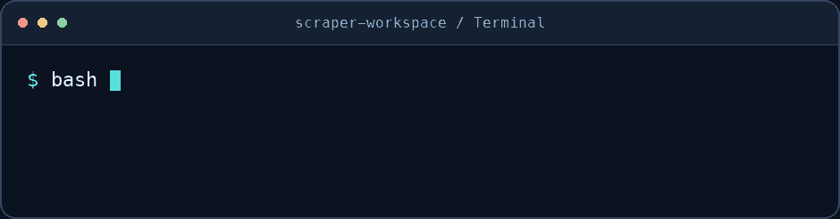

#  Scraper Workspace

Collect data from 20 sources, clean the text, and explore it with charts and tables.
The app stores job history in a local SQLite database. Export results as Excel, CSV, or JSON.

**[Download ZIP](https://github.com/FikriFahruRoji/scraper-workspace/archive/refs/heads/main.zip)** ·
**[Install on macOS or Windows](#install-on-macos-or-windows)** ·
[Example](#example) · [Data sources](#data-sources)



## Install on macOS or Windows

The first run needs an internet connection. The launcher creates a Python
environment in `.venv` and installs the Python packages and Chromium.

### 1. Download and extract the project

1. Open the repository on GitHub and select **Code → Download ZIP** on the
   main branch. [Scraper Workspace repository](https://github.com/FikriFahruRoji/scraper-workspace)
2. Extract the ZIP into a folder you can access, such as **Documents**. On
   Windows, right-click the ZIP and select **Extract All**.
3. Open the extracted folder. The launchers are next to `workspace_app.py`.

### 2. Install Python 3.11

- **macOS.** Download the **macOS 64-bit universal2 installer** from the Python
  3.11.9 release page. Open the `.pkg` and follow the installer. Then open
  **Applications → Python 3.11** and double-click **Install Certificates.command**.
  If you use Homebrew, run `brew install python@3.11` instead.
  [Python 3.11.9 downloads](https://www.python.org/downloads/release/python-3119/)
- **Windows.** Install **Python Install Manager** from python.org. Open
  PowerShell from the Start menu. Skip the install command if the version
  check already reports `Python 3.11.x`.
  [Python on Windows](https://docs.python.org/3.14/using/windows.html)

  ```powershell
  py install 3.11
  py -3.11 --version
  ```

### 3. Open the app

| System | Double-click |
| --- | --- |
| macOS | `Launch Scraper Workspace.command` |
| Windows | `Launch Scraper Workspace.bat` |

Keep Terminal or Command Prompt open while the app runs. Press
<kbd>Ctrl</kbd>+<kbd>C</kbd> there to stop it. Use the same launcher next time.
It runs `pip install` if `requirements.txt` changes or Streamlit is missing.
[Open Scraper Workspace on localhost](http://127.0.0.1:8510)

<details>
<summary>Run from a terminal</summary>

On macOS, open Terminal in the project folder.

```bash
bash "Launch Scraper Workspace.command"
```

On Windows, open PowerShell in the project folder.

```powershell
& ".\Launch Scraper Workspace.bat"
```

</details>

### Troubleshooting

| Symptom | Try this |
| --- | --- |
| Python 3.11 was not found | Finish step 2 and reopen Terminal or PowerShell. Run `python3.11 --version` on macOS or `py -3.11 --version` on Windows. |
| macOS says the `.command` file cannot run because of permissions | Open Terminal, type `bash` with a trailing space, drag the launcher from Finder into Terminal, and press Enter. Run launchers from a copy of the repo you trust. |
| Package or Chromium download failed | Check your connection. Close the launcher and run it again. The error appears in the launcher window. |
| Port 8510 is in use | If Scraper Workspace is already running, open its browser tab. Otherwise use port 8511 with the command below. |
| Python stopped working after you moved the project folder | Close the app, rename `.venv` to `.venv-old`, then run the launcher again. The app stores history and login profiles outside `.venv`. |

**macOS**

```bash
STREAMLIT_SERVER_PORT=8511 bash "Launch Scraper Workspace.command"
```

**Windows (PowerShell)**

```powershell
$env:STREAMLIT_SERVER_PORT = "8511"
& ".\Launch Scraper Workspace.bat"
```

[Open Scraper Workspace on port 8511](http://127.0.0.1:8511)

## Example

**Build a list of papers from Google Scholar**

1. Open **Lakukan Scraping** (Collect Data), choose **Google Scholar**, and select **Cari Kata Kunci** (Keyword Search).
2. Search for `digital literacy higher education` and give the project a name, such as **Digital literacy**.
3. Click **Mulai Ambil Data** (Start). When the job finishes, open **Dataset** and find your project.
4. Check the titles and metadata. Export to Excel or CSV to screen the papers.

<details>
<summary>View the source catalog in the app</summary>


</details>

## Usage

- In **Lakukan Scraping**, search for a source or filter by category. Click
  **Kumpulkan Data**, set the options, and enter a **Nama proyek** (project name).
  Check the summary, then click **Mulai Ambil Data**. You can switch pages while
  a job runs. The app runs one job or platform login session at a time.
- Click **Hentikan** (Stop) to stop a job. A scrape waits for its current
  request to finish.
- In **Dataset**, filter jobs by project, source, or status. Click **Buka** to
  see the settings, results, and methods text. From there you can export the
  results or rerun a scrape with the same settings. Use CSV or JSON for text
  longer than Excel's 32,767-character cell limit. If the app closes mid-job,
  it marks the job **Terputus** (Interrupted) at the next launch and keeps the
  rows saved before it closed.
- **Gabungkan Data** (Merge Data) combines two or more datasets, including
  datasets from different sources. Add `sumber_data` and `pekerjaan_asal` to trace
  each row, or remove duplicate rows. Give the merged dataset a project name.
  Downloads use that name in the filename.
- **Proses Berjalan** (Running Jobs) shows status, saved rows, elapsed time,
  progress, a live log, and the stop button. Starting preprocessing takes you
  there. When the job ends, the page shows its summary and final log.
  **Dataset Preprocessing** keeps the settings, reports, and downloads for
  each saved result.
- Under **Analisis**, use **Statistik Data** for missing values and numeric
  distributions, or **Tren Waktu** for daily, weekly, or monthly counts in
  Western Indonesian Time (WIB). Text tools include word and pair counts,
  TF-IDF + NMF topic modeling, and word co-occurrence networks. Word and topic
  analysis use `teks_bersih` if present or clean the text on the fly, up to
  20,000 texts.
- **Sentimen** can use review stars or the Indonesian RoBERTa model. RoBERTa
  needs the optional packages in `requirements-analysis.txt` and a model
  download. Analysis runs locally, and you can export the result tables to CSV.
  [Analysis guide in Indonesian](docs/ANALISIS.md)
- If a source requires authentication, click **Login platform** and sign in
  manually in the browser. Google Maps Review and Google Maps Lokasi have no
  login button. The Workspace uses its own browser profiles.

The app stores its data in `~/Library/Application Support/ScraperWorkspace` on macOS or `%LOCALAPPDATA%\ScraperWorkspace` on Windows.
Job history and browser profiles are stored separately.

## Data sources

| Source | What you can collect |
| --- | --- |
| Google Scholar | Public researcher profiles, citation history, or publications by keyword |
| Berita (News) | Articles from 10 Indonesian news sites |
| SINTA | Authors by affiliation, profiles and metrics (SINTA, Scopus, Google Scholar, WoS), and sample documents |
| Google Maps Review | Place reviews by URL or name |
| Google Maps Lokasi | Places by keyword, with addresses, ratings, coordinates, and optional details |
| Play Store | App reviews by package ID |
| App Store | iOS app reviews by ID or URL and storefront, up to 500 recent or helpful reviews per app |
| Instagram, Threads, and X | Posts, profiles, search results, or replies, depending on the source |
| YouTube | Video comments and replies |
| Saham (Markets) | Historical OHLCV, dividends, and splits. Also supports crypto and currency pairs such as `USD/IDR` under **Kurs** |
| World Bank | Development indicators such as GDP, inflation, and population, by country and year |
| IMF | World Economic Outlook indicators by country and year, including actual values and projections |
| Harga Pangan (BI) | Daily prices for 21 food staples from PIHPS Bank Indonesia, by province or nationwide and by market type |
| OECD | Roughly 1,500 SDMX datasets, with filters for geography and other dimensions |
| Gempa (USGS) | Earthquakes since 1900 for Indonesia, the world, or a custom bounding box. Includes time in WIB and UTC, magnitude, depth, coordinates, tsunami flag, and felt reports |
| Titik Api (NASA FIRMS) | VIIRS or MODIS hotspots by country and year, with coordinates, time in WIB and UTC, fire radiative power, confidence, day/night, and type |
| Bencana (GDACS & EONET) | Disasters since 2000, excluding earthquakes. Includes floods, cyclones, volcanic eruptions, droughts, and wildfires from GDACS, plus landslides, extreme temperatures, and haze from NASA EONET. Rows include time in WIB and UTC, coordinates, severity, and status |
| Cuaca (Open-Meteo) | Hourly or daily weather for a location, with historical data from 1940 and forecasts up to 16 days |

<details>
<summary>Coverage, limits, and notes by source</summary>

**USGS.** Each request can return at most 20,000 events. The app splits long
date ranges. Indonesia's preset box (11.5°S–6.5°N, 94°–142°E) includes parts of
neighboring countries. Check `tempat` when you need events within Indonesia.
At magnitude 4.5 and above, a year can yield around 1,000 events. Use shorter
ranges at lower magnitudes. USGS data is public domain.

**OECD.** Search the public SDMX catalog for a dataset. The form shows available
dimension codes with labels and displays single-value dimensions as fixed
settings. It stars five datasets with Indonesian coverage. The catalog is
cached locally for seven days. The first load can take up to a minute.
Variable dimensions become table columns and fixed ones go in the job metadata.
Each run makes one data request against the OECD rate limit of around 20 per
hour. Indonesian coverage includes CPI, national accounts, Asia-Pacific taxes,
health expenditure, and life expectancy. Coverage varies for labor and
population datasets.

**NASA FIRMS.** The app uses annual country archives, which are complete after
the calendar year ends. VIIRS (375 m) starts in 2012 and MODIS (1 km) in 2000.
The default cap is 200,000 hotspots. Near-real-time and custom-area endpoints
require a `MAP_KEY` and are outside the archive workflow.

**GDACS and NASA EONET.** The app fetches events by month and removes EONET
copies of GDACS events when you select both sources. GDACS filters for events
that affect Indonesia. Use the worldwide filter for cyclones that stay offshore. EONET filters against an Indonesian bounding box.
The app looks up `provinsi` and `kabupaten_kota` using simplified BPS boundaries
from geoBoundaries/OCHA (CC BY 3.0 IGO), including the 38 provinces after the
2022 Papua changes. Rebuild the boundaries with `tools/build_wilayah.py`. For offshore
points within 20 km, the app records the nearest district and `jarak_wilayah_km`.
More distant points and points outside Indonesia leave those fields blank.
For an area event, the app uses its center. Use USGS for earthquakes. BNPB's
DIBI is the official source for local casualties and damage and requires login.

**Open-Meteo.** The app takes the first geocoding match. Check `lokasi` or
enter `latitude,longitude`. Check Open-Meteo's usage terms before commercial use.

**Public APIs.** World Bank, IMF, OECD, USGS, FIRMS archives, GDACS, NASA EONET,
Open-Meteo, and PIHPS BI use public endpoints without keys or login. IMF
returns full units, such as people or US dollars, and labels values **aktual**
or **proyeksi**. Each row covers one country, indicator, and year. Open
**Ringkasan** to plot an indicator.

**SINTA.** The app uses Scrapling with Chrome impersonation to read author
lists and profiles from the public SINTA site. SINTA shows 10
rotating document samples per list and offers no next page. Use **Contoh
dokumen** for samples or **Profil penulis** for document and citation totals.

</details>

## Google Scholar

Open **Lakukan Scraping → Akademik → Google Scholar**. Use **Profil Scholar**
for a public profile URL or researcher ID. Use **Cari Kata Kunci** for a
topic. Profile collection defaults to HTTP and keyword search defaults to a browser.
You can change the method, page language, or timeout in the form.

Open the job in **Dataset** to filter articles and view charts. Annual citation
counts come from the profile. The search chart ranks the articles that match
your active filters. Downloads contain all rows. Profile Excel exports include
**Artikel**, **Profil**, and **Sitasi per Tahun**. Search exports include
**Hasil** and **Pencarian**. CSV holds the article table. JSON includes metadata.

## Google Maps Lokasi

Open **Lakukan Scraping → Maps & Review → Google Maps Lokasi**. Enter a keyword
such as `kopi bandung` and set a limit of 10–120 results. Add an area to narrow the
search. Results include name, category, address, rating, review count, open status,
coordinates, and place link.

Select **Ambil detail tiap tempat** to fetch phone numbers, websites, plus codes,
and full opening hours. This takes longer because it opens each place page.
Open **Dataset** for the table, map, and category chart, then export to Excel,
CSV, or JSON. Maps usually stops at around 120 results per search. If you get
an empty list, try a broader keyword or add an area.

## NLP preprocessing

Open **Preprocessing Data** with a saved scrape or a CSV/Excel file. Choose
one or more text columns, pick a preset, then adjust the steps. The first 20
rows show how your settings affect the text.

| Step | Ringan (transformer) | Lengkap (word analysis) |
| --- | --- | --- |
| Clean HTML, entities, Unicode NFKC, and whitespace | Always | Always |
| Lowercase | Yes | Yes |
| URLs, emails, and mentions | Replace with tokens | Remove |
| Hashtags | Strip the # | Strip the # |
| Emoji | Convert to words | Remove |
| Repeated letters, e.g. bagusss → bagus | Reduce | Reduce |
| Slang | Normalize | Normalize |
| Numbers | Keep | Remove |
| Punctuation | Keep | Remove except hyphens inside words |
| Stopwords | Keep | Remove while retaining negation |
| Sastrawi stemming | Off | On |
| Minimum token length | Off | 2 |
| Empty or duplicate rows | Drop | Drop |

The pipeline applies slang rules in one pass before removing numbers and
punctuation, so tokens like `b4`, `7an`, `w/` still match.
The default files in `workspace_app/resources/` are `slang.txt` (a JSON object) and
`stopwords.txt` (one word per line). The app flags duplicate keys, self-maps,
and pairs that map back to each other. Uploaded dictionaries override the
defaults for that job. Manual `slang=formal` entries take precedence. Stopwords
can come from the project, Sastrawi, scikit-learn's English list, or an upload.
The Sastrawi root-word dictionary uses CC BY-NC-SA 3.0.

To save the output, select **Simpan ke Riwayat Preprocessing**. The job runs
in the background and stores its settings and step counts. With saving off,
you can download results until the page reloads. Output keeps the input columns
and adds `teks_bersih` and `jumlah_token`. Saved scrape inputs include `pekerjaan_asal`.
If the input already has `teks_bersih` or `jumlah_token`, the app copies the original
values to columns with a unique `_asli` suffix.

## Deployment

Use `workspace_app.py` as Streamlit's entry point and `requirements.txt` for
dependencies. Each installation has one shared job queue, history database,
and set of browser profiles. On a server, restrict access to its operator.
[Linux and Streamlit Community Cloud deployment](docs/DEPLOYMENT.md)

## Project layout

```text
workspace_app.py      Streamlit entry point and navigation
workspace_app/        Forms, jobs, preprocessing, analysis, and Google Scholar
scrapers/             Other source adapters, grouped by source
scrapers/_shared/     Shared browser transport
tests/                Automated tests
tools/                Manual checks and data build tools
docs/                 Deployment, browser setup, and analysis guides
.streamlit/           Streamlit settings and theme
```

To add a source, put its adapter in `scrapers/<key>/scraper.py` and register it in
`workspace_app/sources.py` and `workspace_app/studio.py`.

## Icon credits

Source logos come from [Simple Icons](https://simpleicons.org) (CC0).
Other symbols come from [Material Symbols](https://fonts.google.com/icons)
(Apache 2.0). The SVG files live in `workspace_app/resources/icons/`.

## Developer checks

Run these commands with the project's virtual environment active.

```bash
python -m pip install pytest
python -m pytest -q tests
```

The tests cover source forms, job execution and cancellation, recovery of
partial results, project names, preprocessing, and exports. The optional
RoBERTa test needs the model and `RUN_SLOW=1`. For manual checks, run:

```bash
python tools/check_news_performance.py
python tools/check_transport.py
```
