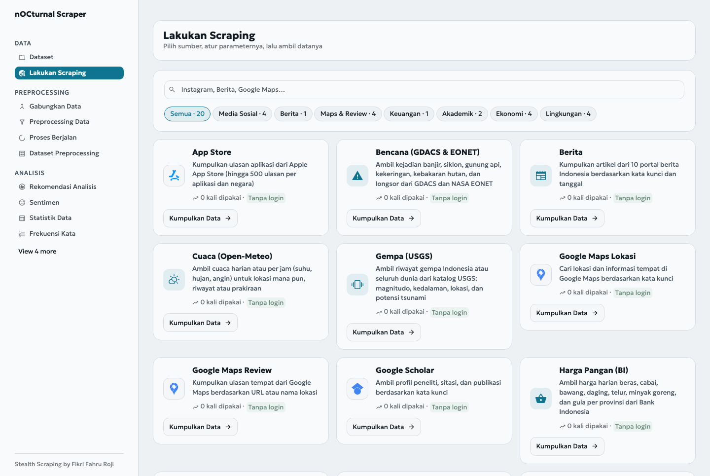

<div align="center">


# Scraper Workspace

**Collect data from 20 sources, clean Indonesian & multilingual text, and run research-grade analysis — locally and privately.**

[](https://www.python.org/downloads/release/python-3119/)
[](https://streamlit.io/)
[](https://github.com/D4Vinci/Scrapling)
[](#data-sources)
[](#why-scraper-workspace)

[Download ZIP](https://github.com/FikriFahruRoji/scraper-workspace/archive/refs/heads/main.zip) ·
[Quick Start](#quick-start) ·
[Analysis Suite](#analysis-suite) ·
[Data Sources](#data-sources) ·
[NLP Preprocessing](#nlp-preprocessing) ·
[Deployment](docs/DEPLOYMENT.md)

<br>


</div>

---

## Why Scraper Workspace?

- **Free, no tokens, no pay-per-row** — run scrapes and analyses on your own machine or server without external quotas.
- **Local & private by default** — job history (SQLite), datasets, and browser login profiles stay on your disk.
- **Stealth browser + manual login** — powered by Scrapling with isolated browser profiles for authenticated platforms.
- **End-to-end research pipeline** — collect → merge → clean Indonesian/English text → analyze → export to Excel, CSV, or JSON with ready-to-cite method paragraphs.
- **Bilingual interface** — switch between Indonesian (`id`) and English (`en`) directly in the sidebar.

<details>
<summary>Preview: Source catalog in the app</summary>



</details>

---

## Quick Start

The first run requires an internet connection to create `.venv`, install Python packages, and download Chromium.

### 1. Download & extract
1. Open the [Scraper Workspace repository](https://github.com/FikriFahruRoji/scraper-workspace) and choose **Code → Download ZIP**.
2. Extract the ZIP into a folder you can access (such as **Documents**).

### 2. Install Python 3.11
- **macOS:** Install the **macOS 64-bit universal2 installer** from [Python 3.11.9](https://www.python.org/downloads/release/python-3119/), then open **Applications → Python 3.11** and run **Install Certificates.command** (or `brew install python@3.11`).
- **Windows:** Install **Python Install Manager** from [python.org](https://docs.python.org/3.14/using/windows.html), then run in PowerShell:
  ```powershell
  py install 3.11
  py -3.11 --version
  ```

### 3. Launch the app

| OS | Double-click | Local URL |
| --- | --- | --- |
| **macOS** | `Launch Scraper Workspace.command` | http://127.0.0.1:8510 |
| **Windows** | `Launch Scraper Workspace.bat` | http://127.0.0.1:8510 |

Keep the terminal window open while using the app (`Ctrl+C` to stop). The launcher automatically updates dependencies if `requirements.txt` changes.

<details>
<summary>Run from terminal, custom port, & troubleshooting</summary>

**Run from terminal:**
```bash
# macOS
bash "Launch Scraper Workspace.command"
```
```powershell
# Windows (PowerShell)
& ".\Launch Scraper Workspace.bat"
```

**Use a different port (e.g. `8511`):**
```bash
# macOS
STREAMLIT_SERVER_PORT=8511 bash "Launch Scraper Workspace.command"
```
```powershell
# Windows (PowerShell)
$env:STREAMLIT_SERVER_PORT = "8511"
& ".\Launch Scraper Workspace.bat"
```

| Symptom | Fix |
| --- | --- |
| Python 3.11 was not found | Finish step 2, reopen Terminal/PowerShell, and verify `python3.11 --version` or `py -3.11 --version`. |
| macOS blocks `.command` permissions | Type `bash ` in Terminal, drag `Launch Scraper Workspace.command` into the window, and press Enter. |
| Package or Chromium download failed | Check your internet connection and re-run the launcher. |
| Python broke after moving the folder | Close the app, rename `.venv` to `.venv-old`, and re-run the launcher (history & profiles are stored outside `.venv`). |

</details>

---

## Analysis Suite

Scraper Workspace automatically profiles your dataset and recommends suitable analyses in **Rekomendasi Analisis** (all 8 stages **A–G + Cross-Dataset** are available; see full method specifications in [docs/ANALISIS.md](docs/ANALISIS.md)).

| Family | Data Type | Built-in Analyses |
| --- | --- | --- |
| **A · Reviews** | Play Store, App Store, Google Maps Reviews | Indonesian RoBERTa sentiment, rating-trained TF-IDF + Logistic Regression, star–text mismatch (Cohen's κ), aspect sentiment, trends by month/version |
| **B · Social Media** | Instagram, X, Threads, YouTube | Sentiment, Emotion (EmoT RoBERTa) & Toxicity (IndoBERTweet), Reply Network (PageRank, betweenness, Louvain + Gephi export), interaction inequality (Gini, Kruskal–Wallis), repeated text detection |
| **C · News** | Indonesian News Portals | Distinct portal words (weighted log-odds), sentiment per portal (χ² + Cramér's V), NMF topics & BERTopic over time (UMAP + HDBSCAN + NPMI coherence) |
| **D · Time Series** | Stocks, Food Prices, Weather | Rolling-origin forecast (AutoETS, AutoARIMA, MSTL vs naive), STL decomposition + ADF/KPSS, Ramadan/Eid effect, stock returns/RSI/MACD/GARCH(1,1), weather anomalies |
| **E · Country Panel** | World Bank, IMF, OECD | Annual trends & CAGR, Pearson/Spearman indicator correlation, k-means country clustering, fixed-effects panel regression (`PanelOLS`) |
| **F · Geospatial** | USGS, NASA FIRMS, Disasters, GMaps Places | Dynamic `pydeck` maps (Indonesia-first viewport, constant-pixel circles on zoom, Light/Dark/Voyager styles, hover tooltips), hexagon density, HDBSCAN spatial clustering, offline Indonesian province/district aggregation, Gutenberg–Richter b-value & depth profile |
| **G · Bibliometrics** | Google Scholar, SINTA | Co-author network (NetworkX + Louvain), annual citations & h-index, NMF title topics, SINTA profile distributions (Scopus vs GS) |
| **Cross-Dataset** | Any two dated datasets | Date/region alignment, cross-correlation across lags, bidirectional Granger causality tests |

> **Optional AI & econometrics models:** Core lightweight features work out of the box. To enable transformer sentiment/emotion/toxicity, BERTopic, time-series forecasting, and `linearmodels` panel regression, install:
> ```bash
> pip install -r requirements-analysis.txt
> ```

---

## Data Sources

| Category | Source | What you can collect |
| --- | --- | --- |
| **Academic** | **Google Scholar** | Public researcher profiles, citation history, or publications by keyword |
| | **SINTA** | Authors by affiliation, metrics (SINTA, Scopus, Google Scholar, WoS), and sample documents |
| **News** | **Berita (News)** | Articles from 10 Indonesian news portals |
| **Maps & Reviews** | **Google Maps Review** | Place reviews by URL or name |
| | **Google Maps Lokasi** | Places by keyword with address, rating, coordinates, and optional details |
| | **Play Store** | Android app reviews by package ID |
| | **App Store** | iOS app reviews by ID/URL and storefront (up to 500 recent or helpful reviews) |
| **Social Media** | **Instagram, Threads, X** | Posts, profiles, search results, or replies (with manual browser login support) |
| | **YouTube** | Video comments and replies |
| **Markets & Macro** | **Saham (Markets)** | Historical OHLCV, dividends, splits, crypto, and FX pairs (e.g. `USD/IDR`) |
| | **Harga Pangan (BI)** | Daily prices for 21 food staples from PIHPS Bank Indonesia |
| | **World Bank** | Development indicators (GDP, inflation, population, etc.) by country and year |
| | **IMF** | World Economic Outlook indicators (actuals & projections) |
| | **OECD** | ~1,500 SDMX datasets with geography & dimension filters |
| **Disasters & Climate** | **Gempa (USGS)** | Earthquakes since 1900 (WIB & UTC, magnitude, depth, coordinates, tsunami flag) |
| | **Titik Api (NASA FIRMS)** | VIIRS / MODIS fire hotspots by country and year (FRP, confidence, coordinates) |
| | **Bencana (GDACS & EONET)** | Floods, cyclones, volcanoes, droughts, landslides, haze since 2000 |
| | **Cuaca (Open-Meteo)** | Hourly/daily historical weather (from 1940) and 16-day forecasts |

<details>
<summary>Coverage, limits, and notes by source</summary>

- **USGS:** Max 20,000 events per request (long ranges are split automatically). Indonesia's preset box (`11.5°S–6.5°N, 94°–142°E`) includes parts of neighboring countries; filter `tempat` when needed. Public domain.
- **OECD:** Searches the public SDMX catalog (cached locally for 7 days; ~20 requests/hour rate limit). Stars five datasets with Indonesian coverage.
- **NASA FIRMS:** Uses annual country archives (VIIRS 375m from 2012, MODIS 1km from 2000; default cap 200,000 hotspots).
- **GDACS & NASA EONET:** Deduplicates overlapping events and enriches Indonesian coordinates with `provinsi` and `kabupaten_kota` using offline BPS/geoBoundaries/OCHA boundaries (CC BY 3.0 IGO, 38 provinces). Rebuild with `tools/build_wilayah.py`.
- **Open-Meteo:** Uses the first geocoding match (or direct `latitude,longitude`). Check Open-Meteo's terms before commercial use.
- **Public APIs:** World Bank, IMF, OECD, USGS, FIRMS archives, GDACS, EONET, Open-Meteo, and PIHPS BI require no API keys or login.
- **SINTA:** Uses Scrapling Chrome impersonation on public pages. Shows 10 rotating document samples per list; use **Profil penulis** for aggregate metrics.
- **Google Maps Lokasi:** Usually caps around 120 results per search. Enabling **Ambil detail tiap tempat** visits each place page for phone, website, plus code, and hours.

</details>

---

## Example Workflow

1. Open **Lakukan Scraping**, pick a source (e.g. **Google Scholar → Cari Kata Kunci**), enter a query and **Nama proyek**, then click **Mulai Ambil Data**.
2. Monitor live progress in **Proses Berjalan** (you can switch pages freely while one job runs; closing mid-job safely marks it **Terputus** while preserving saved rows).
3. Inspect, filter, or combine datasets in **Dataset** and **Gabungkan Data**.
4. Clean text in **Preprocessing Data**, then explore insights in **Rekomendasi Analisis** or dedicated analysis pages.
5. Export tables to **Excel**, **CSV**, or **JSON** (use CSV/JSON for texts exceeding Excel's 32,767-character cell limit).

> App data is stored in `~/Library/Application Support/ScraperWorkspace` (macOS) or `%LOCALAPPDATA%\ScraperWorkspace` (Windows).

---

## NLP Preprocessing

Open **Preprocessing Data** with a saved scrape or uploaded CSV/Excel file. Preview the first 20 rows live before saving to **Dataset Preprocessing**.

| Step | Ringan (Transformer) | Lengkap (Word Analysis) |
| --- | --- | --- |
| HTML, entities, NFKC, whitespace | Always | Always |
| Lowercase | Yes | Yes |
| URLs, emails, & mentions | Replace with tokens | Remove |
| Hashtags | Strip `#` | Strip `#` |
| Emoji | Convert to words | Remove |
| Repeated letters (`bagusss → bagus`) | Reduce | Reduce |
| Slang normalization (`slang.txt`) | Normalize | Normalize |
| Numbers & punctuation | Keep | Remove (keep intra-word hyphens) |
| Stopwords (`stopwords.txt`) | Keep | Remove (retaining negation) |
| Sastrawi stemming (CC BY-NC-SA 3.0) | Off | On |
| Minimum token length | Off | 2 |

Output preserves original columns and appends `teks_bersih` and `jumlah_token` (existing columns with those names are backed up with an `_asli` suffix).

---

## Project Layout & Developer Docs

```text
workspace_app.py        Streamlit entry point and navigation
workspace_app/          Views, job queue, preprocessing, analysis modules, Google Scholar
scrapers/               Source adapters (20 sources)
scrapers/_shared/       Shared stealth HTTP/browser transport
tests/                  Automated unit & Streamlit AppTest suite
tools/                  Performance checks and boundary builders
docs/                   Analysis spec, deployment, and stealth guides
.streamlit/             Streamlit server & theme configuration
```

- **Deployment:** [docs/DEPLOYMENT.md](docs/DEPLOYMENT.md) (Linux VPS & Streamlit Community Cloud)
- **Stealth Mode:** [docs/STEALTH_MODE.md](docs/STEALTH_MODE.md)
- **Analysis Spec:** [docs/ANALISIS.md](docs/ANALISIS.md)

### Developer Checks

```bash
python -m pip install pytest
python -m pytest -q tests
```

Optional slow RoBERTa tests require model weights and `RUN_SLOW=1`. Manual checks:

```bash
python tools/check_news_performance.py
python tools/check_transport.py
```

---

## Credits

- **Stealth scraping & workspace** by **Fikri Fahru Roji**
- Source logos from [Simple Icons](https://simpleicons.org) (CC0); UI icons from [Material Symbols](https://fonts.google.com/icons) (Apache 2.0) in `workspace_app/resources/icons/`.
