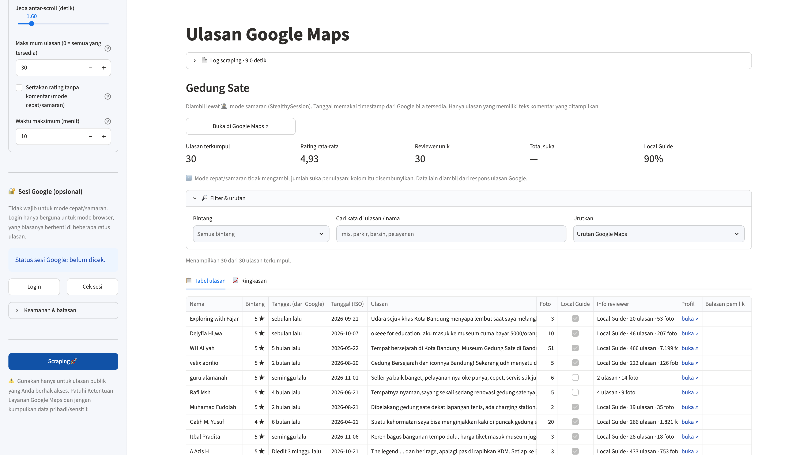

> **Pembaruan 14 November 2026:** jalur pengambilan default kini memakai
> browser `scrapling.fetchers.StealthySession` (stealth), termasuk permintaan
> endpoint Play Store, Yahoo Finance, dan YouTube. Instruksi/uraian mode HTTP
> lama di bawah merupakan dokumentasi sebelum migrasi; lihat
> [panduan stealth bersama](../STEALTH_MODE.md) untuk konfigurasi terbaru.

# Google Maps Review Scraper



Ambil **ulasan/komentar publik** dari sebuah tempat di **Google Maps** hanya
dengan menempelkan link lokasi. Proyek ini memakai **Python + Scrapling** dan
**Streamlit** untuk antarmuka, dengan dua mode pengambilan:

- **⚡ Cepat** — memanggil endpoint ulasan internal Google secara berpaginasi
  lewat HTTP Scrapling. Bisa mengambil **ribuan ulasan** tanpa login.
- **🥷 Samaran** — endpoint yang sama, tetapi request dijalankan dari browser
  **StealthySession** (profil Chrome persisten). Lebih lambat, tetapi lebih
  tahan terhadap pembatasan Google. **Mode ini yang dipakai secara default.**
- **🖥️ Browser** — menggulir tampilan Google Maps. Paling lambat dan biasanya
  berhenti di beberapa ratus kartu karena batas tampilan Google.

Konsepnya sama seperti proyek `threads-scraper` dan `x-tweet-scraper`:
sesi browser persisten (opsional), scraping berjalan di background, log proses
live, tabel hasil, ringkasan, serta ekspor CSV/JSON.

> ## ⚠️ Baca sebelum memakai
>
> Google Maps tidak secara bebas mengizinkan pengambilan data otomatis.
> Gunakan proyek ini hanya untuk **ulasan publik yang Anda berhak akses**,
> dengan izin/otorisasi yang sesuai, dan patuhi
> [Ketentuan Layanan Google Maps](https://www.google.com/help/terms_maps/)
> serta hukum yang berlaku.
>
> Aplikasi ini **tidak** melewati CAPTCHA, paywall, atau kontrol akses, dan
> tidak memakai proxy untuk menyamarkan diri. Aplikasi tidak menyediakan login
> Google. Jika Anda membutuhkan data yang
> lengkap dan legal untuk produksi, gunakan **Google Places API** resmi.

## Fitur

- Input **link tempat Google Maps** (link panjang, `maps.app.goo.gl`, atau nama tempat).
- Validasi link: hanya host Google Maps yang diproses.
- **Mode cepat / samaran**: ambil ulasan per halaman lewat endpoint ulasan
  Google, dengan pilihan urutan Paling relevan / Terbaru / Rating tertinggi /
  Rating terendah.
- **Mode browser**: buka tab Ulasan, gulir daftar, dan perluas teks yang terpotong.
- Ambil data: nama reviewer, rating, tanggal relatif, teks ulasan, jumlah suka,
  jumlah foto, status Local Guide, info kontribusi reviewer, URL profil,
  balasan pemilik (bila ada), dan ID ulasan.
- Metadata tempat: nama, kategori, alamat, telepon, website, rating, jumlah ulasan,
  `place_id`, dan link final.
- Mode headless / browser tampak, Chrome asli / Chromium Scrapling.
- Batas maksimum ulasan dan waktu, jeda berkala untuk mengurangi risiko rate-limit.
- **Log live** dan proses di background agar UI tidak membeku.
- Filter bintang, pencarian kata, dan pengurutan hasil.
- Ringkasan: distribusi bintang, perkiraan ulasan per bulan, reviewer teraktif.
- Ekspor **CSV** dan **JSON**.

## Persyaratan

- **Python 3.10+** (diuji dengan Python 3.11)
- Google Chrome terpasang (disarankan; ada cadangan Chromium dari Scrapling)
- macOS, Linux, atau Windows. Launcher klik-dua-kali disediakan untuk macOS.

## Instalasi

```bash
cd gmaps-reviews-scraper

# 1. Virtual environment
python3.11 -m venv .venv
source .venv/bin/activate

# 2. Dependensi
pip install -r requirements.txt

# 3. (Opsional) browser cadangan Chromium untuk Scrapling
scrapling install --force
```

## Menjalankan

### Cara cepat (macOS)

Klik dua kali **`Jalankan Google Maps Scraper.command`**. Terminal akan
membuka aplikasi di browser. Tutup jendela Terminal untuk menghentikan server.

> Pertama kali: jika macOS memblokir, klik kanan file → **Open**, atau jalankan
> `chmod +x "Jalankan Google Maps Scraper.command"` sekali.

### Manual

```bash
source .venv/bin/activate
streamlit run app.py
```

Buka URL yang muncul (biasanya <http://localhost:8501>).

## Alur pakai

1. Buka tempat di Google Maps → **Bagikan** → **Salin link**.
2. Tempel link di sidebar aplikasi.
3. Pilih **metode pengambilan**:
   - **🥷 Samaran** — default; request lewat browser stealth.
   - **⚡ Cepat** — HTTP langsung, paling cepat.
   - **🖥️ Browser** — membuka tampilan Google Maps; hasilnya terbatas.
4. Atur urutan (mode cepat), batas ulasan/waktu bila perlu, lalu klik **Scraping 🚀**.
5. Lihat log live. Setelah selesai, filter/telusuri hasil dan unduh CSV/JSON.

## Tiga mode pengambilan

**Mode samaran (default)** menjalankan request endpoint ulasan yang sama dari
dalam browser `StealthySession` memakai `page.evaluate(fetch(...))`. Karena
request berasal dari origin Google dan memakai profil browser, mode ini lebih
tahan terhadap pembatasan/rate-limit dibanding HTTP langsung. Kelemahannya
lebih lambat karena harus membuka Chrome.

Kedua mode meminta **60 ulasan per halaman** (batas maksimum endpoint), bukan
10–20. Pada pengujian, 1.000 komentar selesai dalam ±28 detik dan 5.000 baris
tercapai tanpa batas keras. Untuk 122 ribu rating, perkirakan **±40–90 menit**
tergantung jaringan dan pembatasan Google; naikkan **Waktu maksimum** ke
60–120 menit.

**Mode cepat** memakai endpoint ulasan internal Google
(`GetLocalBoqProxy`). Endpoint ini mengembalikan sekitar 20 ulasan per halaman
dan punya token halaman berikutnya. Scraper terus meminta halaman berikutnya
sampai batas ulasan/waktu tercapai atau token habis. Pada pengujian, mode ini
bisa melewati 590+ ulasan dengan mudah — jauh lebih banyak daripada mode browser.
Uji lain berhasil mengambil **1.000 komentar teks dalam ±99 detik**.

**Mode browser** membuka tampilan Google Maps seperti manusia. Karena tanpa
login, Google biasanya menampilkan tampilan terbatas (sering hanya ±5 ulasan).
Ini batas dari Google, bukan bug scraper.

> Endpoint mode cepat adalah API internal yang **tidak terdokumentasi resmi**.
> Google dapat mengubah, membatasi, atau menutupnya kapan saja. Gunakan hanya
> untuk data publik yang Anda berhak akses dan sesuai Ketentuan Layanan Google.

## Cara kerja

### Mode cepat / samaran

1. Ambil `place_id` (`0x...:0x...`) dari link tempat.
2. Scrapling memanggil endpoint ulasan Google untuk halaman pertama, lalu
   mengikuti token pagination. Mode cepat memakai `FetcherSession`; mode
   samaran memakai `StealthySession` + `fetch()` dari halaman Google Maps.
3. Setiap ulasan dipetakan ke kolom tabel, dideduplikasi berdasarkan ID ulasan,
   dan tanggalnya diambil dari timestamp Google bila tersedia.
4. Proses berhenti saat token habis, batas ulasan/waktu tercapai, atau endpoint
   menolak permintaan.
5. Jika `place_id` tidak ada di link pendek, browser dipakai sekali untuk
   me-resolve link, lalu pengambilan ulasan tetap lewat mode cepat.

### Mode browser

1. Scrapling (`StealthySession`) membuka link tempat dengan locale `id-ID`.
2. Aplikasi membuka tab **Ulasan**, mengeklik semua tombol **Lainnya**, lalu
   mengekstrak kartu dan menggulir ke dasar untuk memicu batch berikutnya.
3. Data dideduplikasi berdasarkan `data-review-id`.
4. Tanggal relatif seperti “3 bulan lalu” diubah menjadi **perkiraan** tanggal
   absolut (bulan = 30 hari, tahun = 365 hari).

## Kolom hasil

| Kolom | Keterangan |
|---|---|
| `nama` | Nama reviewer |
| `rating` | 1–5 bintang |
| `tanggal` | Label tanggal asli dari Google Maps (mis. “3 bulan lalu”) |
| `perkiraan_tanggal` | Tanggal `YYYY-MM-DD`; timestamp asli di mode cepat, perkiraan di mode browser |
| `ulasan` | Teks ulasan lengkap |
| `suka` | Jumlah suka pada ulasan |
| `foto` | Perkiraan jumlah foto dalam ulasan |
| `local_guide` | Reviewer berstatus Local Guide |
| `info_reviewer` | Teks kontribusi reviewer dari Google |
| `ulasan_reviewer` | Jumlah ulasan yang pernah ditulis reviewer |
| `foto_reviewer` | Jumlah foto yang pernah diunggah reviewer |
| `profil` | URL profil reviewer |
| `foto_profil` | URL foto profil |
| `balasan_pemilik` | Balasan pemilik tempat, bila ada |
| `id_ulasan` | ID internal ulasan Google |
| `link_ulasan` | Link langsung ke ulasan (tersedia di mode cepat) |
| `tempat`, `link_tempat` | Nama dan link tempat |

## Soal jumlah ulasan (mis. 9.048 vs 480)

Angka besar seperti **“9.048 ulasan”** pada halaman Google Maps adalah jumlah
**rating**, termasuk rating tanpa komentar. Feed web mode browser tidak
menampilkan semuanya; pada pengujian Gedung Sate feed berhenti di ±430 kartu,
dan pengguna lain bisa mendapat ±480 tergantung sesi. Itu batas tampilan Google,
bukan jumlah komentar yang tersimpan di scraper.

**Mode cepat** dapat menembus batas tampilan browser tersebut dan biasanya
mengambil jauh lebih banyak ulasan. Meski begitu, API internal Google juga bisa
punya batasnya sendiri (mis. beberapa ribu ulasan per tempat) dan dapat berhenti
memberikan token kapan saja. Jadi:

- Jangan menyamakan “9.048 rating” dengan “9.048 komentar teks”.
- Untuk tempat dengan puluhan ribu rating, tidak ada jaminan semua komentar bisa
  diambil; yang tersedia adalah sebanyak yang diberikan endpoint Google.
- Jika butuh data kontrak/produksi, gunakan penyedia resmi/berlisensi atau
  **Google Business Profile API** bila Anda pemilik lokasi.

## Batasan

- **Mode cepat**: bergantung pada endpoint internal Google; dapat berhenti,
  membatasi, atau berubah tanpa pemberitahuan. Jumlah suka per ulasan tidak
  diambil pada mode ini.
- **Mode browser**: biasanya hanya sekitar 5 ulasan pertama karena aplikasi
  tidak memakai login Google.
- Jumlah total rating di Google **tidak sama** dengan jumlah komentar teks yang
  dapat diambil.
- Google dapat memperlambat atau menghentikan endpoint setelah ribuan request;
  gunakan waktu maksimum yang wajar dan jangan jalankan terlalu sering.
- Tanggal di mode cepat memakai timestamp dari Google; di mode browser tanggal
  absolut hanyalah perkiraan.
- Google Maps sering mengubah struktur DOM. Jika scraper berhenti menemukan
  ulasan, selector di `scraper.py` mungkin perlu diperbarui.
- Ulasan dapat memuat data pribadi reviewer. Jangan menyebarkan data pribadi
  tanpa dasar yang sah.
- Google dapat memblokir atau membatasi akses kapan saja. Tidak ada jaminan
  hasil selalu tersedia.

## Troubleshooting

**Hanya dapat 5 ulasan**\
Itu batas tampilan Google untuk pengunjung tanpa login. Pakai **mode samaran**
atau **mode cepat**, dan pastikan link tempat sudah tepat.

**Chrome gagal dibuka**\
Nonaktifkan **“Gunakan Google Chrome asli”** di Opsi lanjutan, lalu coba lagi.
Pastikan dependensi browser sudah terpasang (`scrapling install --force`).

**Tidak ada ulasan**\
Pastikan link menunjuk ke **tempat**, bukan daftar pencarian/profil. Tempat
harus memiliki ulasan publik. Coba buka link yang sama di browser biasa.

**Proses lama / menggulir terus**\
Turunkan **Maksimum ulasan** dan **Waktu maksimum** di sidebar. Di mode browser,
aplikasi berhenti lebih cepat setelah mencapai batas tampilan.

## Struktur proyek

```
gmaps-reviews-scraper/
├── Jalankan Google Maps Scraper.command  # Launcher macOS
├── app.py                 # Antarmuka Streamlit
├── scraper.py             # Logika scraping & parsing (Scrapling)
├── requirements.txt
├── README.md
├── .streamlit/
│   └── config.toml
└── sessions/              # Profil browser untuk scraping
```

> Folder `sessions/` berisi profil browser yang dipakai saat scraping. Folder ini
> boleh dihapus kapan saja.
