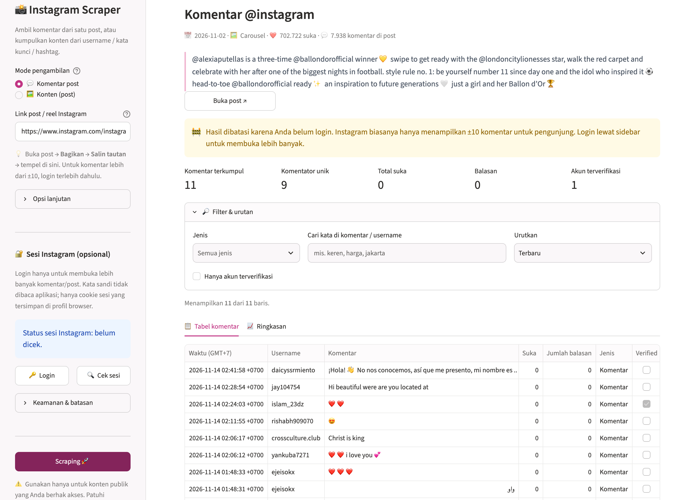

> **Pembaruan 14 November 2026:** jalur pengambilan default kini memakai
> browser `scrapling.fetchers.StealthySession` (stealth), termasuk permintaan
> endpoint Play Store, Yahoo Finance, dan YouTube. Instruksi/uraian mode HTTP
> lama di bawah merupakan dokumentasi sebelum migrasi; lihat
> [panduan stealth bersama](../STEALTH_MODE.md) untuk konfigurasi terbaru.

# Instagram Scraper



Ambil **komentar publik** dari sebuah post/reel Instagram, atau kumpulkan
**konten/postingan** dari **username**, **kata kunci**, dan **hashtag** —
hanya dengan menempelkan link atau mengetik sumbernya. Proyek ini memakai
**Python + Scrapling** dan **Streamlit** untuk antarmuka.

Konsepnya sama seperti proyek `gmaps-reviews-scraper`,
`playstore-reviews-scraper`, `threads-scraper`, dan `x-tweet-scraper`:
scraping berjalan di background, log proses live, sesi browser persisten
(opsional), tabel hasil, filter, ringkasan, serta ekspor **CSV/JSON**.

Dua mode utama:

- **💬 Komentar post** — tempel link post/reel. Ambil username, teks komentar,
  waktu, suka, balasan, dan status verifikasi.
- **🖼️ Konten (post)** — masukkan username, kata kunci, atau hashtag. Ambil
  caption, tanggal, jenis media, suka, komentar, tayangan, dan link post.

> ## ⚠️ Baca sebelum memakai
>
> Instagram tidak secara bebas mengizinkan pengambilan data otomatis. Gunakan
> proyek ini hanya untuk **konten publik yang Anda berhak akses**, dengan
> izin/otorisasi yang sesuai, dan patuhi
> [Ketentuan Layanan Instagram](https://help.instagram.com/581066165581870)
> serta hukum yang berlaku.
>
> Aplikasi ini **tidak** melewati CAPTCHA, paywall, login, atau kontrol akses
> apa pun, dan **tidak** memakai proxy untuk menyamarkan diri. Login bersifat
> manual, memakai akun Anda sendiri, dan hanya menyimpan profil browser.
> Jangan mengumpulkan data pribadi/sensitif. Untuk kebutuhan produksi,
> gunakan jalur/API resmi yang sesuai.

## Fitur

- **Dua mode**: komentar dari link post/reel, atau konten dari username /
  kata kunci / hashtag.
- Input **link post** yang fleksibel: `/p/`, `/reel/`, `/tv/`, link share
  Instagram, atau kode post saja.
- Input **username** fleksibel: `instagram`, `@instagram`, atau link profil.
- Input **hashtag** fleksibel: `#ballondor`, `ballondor`, atau link hashtag.
- **Login Instagram opsional** lewat browser tampak; sesi disimpan di profil
  browser terpisah (`sessions/instagram_profile`). Kata sandi tidak dibaca
  aplikasi.
- **Cek sesi instan** dengan membaca database cookie profil secara lokal,
  tanpa membuka browser dan tanpa mengunci profil.
- Mode **kata kunci** memeriksa sesi lebih dulu, sehingga tidak menggantung di
  halaman login ketika Anda belum masuk.
- Mode **kata kunci** membaca respons UI Instagram 2026
  (`xdt_fbsearch__top_serp_graphql`) sekaligus endpoint lama, termasuk thumbnail
  dari `image_versions2`.
- Scraping komentar membaca data yang sudah tertanam di HTML **dan** menangkap
  respons GraphQL internal. Daftar komentar digulir dengan **event wheel nyata**
  pada kontainer komentar (bukan hanya mengubah `scrollTop`), lalu tombol
  **View all replies** diklik untuk membuka balasan.
- Scraping konten membaca data dari HTML + respons GraphQL saat daftar post
  digulir.
- Deduplikasi komentar/post, penggabungan data dari beberapa respons, dan
  pemfilteran akun yang tidak relevan pada mode profil.
- **Slide carousel tidak dihitung sebagai post terpisah.** Satu post carousel
  tetap satu baris; slide anaknya tidak muncul sebagai baris tanpa
  username/caption.
- **Metrik yang tidak tersedia disimpan `null`**, bukan `0`. Kolom yang seluruh
  nilainya kosong (mis. tayangan pada feed profil) disembunyikan dari tabel,
  dan CSV/JSON mengosongkannya agar tidak menyesatkan.
- Opsi **sertakan balasan komentar**, **maksimum komentar/post**, **waktu
  maksimum**, **jeda antar-gulir**, **mode headless**, dan **Chrome asli**.
- **Filter rentang tanggal** opsional untuk mode konten.
- Proses di **background thread** dengan **log live**, tombol **Hentikan**,
  dan hasil sementara tetap disimpan bila dihentikan.
- Tabel interaktif dengan filter jenis komentar, pencarian kata, filter akun
  terverifikasi, filter jenis media, dan pengurutan.
- Ringkasan: komentar/post per hari, komposisi jenis/media, komentator/akun
  teratas, dan komentar/post paling disukai.
- Ekspor **CSV** (UTF-8 + BOM, rapi di Excel) dan **JSON** (termasuk metadata
  post/profil dan parameter proses).

## Persyaratan

- **Python 3.10+** (diuji dengan Python 3.11)
- Koneksi internet ke Instagram
- **Google Chrome** terpasang (disarankan; ada cadangan Chromium dari
  Scrapling)
- macOS, Linux, atau Windows. Launcher klik-dua-kali disediakan untuk macOS.

## Instalasi

```bash
cd instagram-scraper

# 1. Virtual environment
python3.11 -m venv .venv
source .venv/bin/activate

# 2. Dependensi
pip install -r requirements.txt

# 3. (Opsional) browser cadangan Chromium untuk Scrapling
scrapling install --force
```

## Menjalankan

### Cara cepat (macOS)

Klik dua kali **`Jalankan Instagram Scraper.command`**. Terminal akan membuka
aplikasi di browser. Tutup jendela Terminal untuk menghentikan server.

> Pertama kali: jika macOS memblokir, klik kanan file → **Open**, atau jalankan
> `chmod +x "Jalankan Instagram Scraper.command"` sekali.

### Manual

```bash
source .venv/bin/activate
streamlit run app.py
```

Buka URL yang muncul (biasanya <http://localhost:8501>).

## Alur pakai

### Mode komentar

1. Buka post/reel di Instagram → **Bagikan** → **Salin tautan**.
2. Di sidebar, pilih **💬 Komentar post**, lalu tempel link.
3. (Disarankan) Klik **🔑 Login** dan masuk dengan akun Anda sendiri. Tanpa
   login, Instagram biasanya hanya menampilkan **±10 komentar**.
4. Atur **Sertakan balasan**, **Maksimum komentar**, dan **Waktu maksimum**
   bila perlu.
5. Klik **Scraping 🚀**. Lihat log live; UI tetap responsif.
6. Setelah selesai, saring/telusuri komentar, lihat **Ringkasan**, lalu unduh
   **CSV/JSON**.

### Mode konten

1. Pilih **🖼️ Konten (post)**.
2. Pilih sumber:
   - **👤 Username** — satu akun, mis. `instagram`.
   - **🔎 Kata kunci** — pencarian Instagram, mis. `ballon d'or`
     (**memerlukan login**).
   - **#️⃣ Hashtag** — mis. `#ballondor` (bisa tanpa login, hasil terbatas).
3. Atur maksimum post, waktu, dan filter tanggal bila perlu.
4. Klik **Scraping 🚀**, lalu unduh hasilnya.

Contoh input:

| Mode | Contoh |
|---|---|
| Komentar | `https://www.instagram.com/p/DfPQchkG1tg/` |
| Komentar | `https://www.instagram.com/reel/DfsGt_WvvsH/` |
| Konten · Username | `instagram`, `@instagram`, `https://www.instagram.com/instagram/` |
| Konten · Kata kunci | `ballon d'or`, `resep rendang` |
| Konten · Hashtag | `#ballondor`, `ballondor` |

## Opsi di sidebar

| Opsi | Keterangan |
|---|---|
| Mode pengambilan | Komentar post atau konten. |
| Link post / reel | Input utama mode komentar. Menerima `/p/`, `/reel/`, `/tv/`, link share, atau kode post. |
| Jenis input | Username, kata kunci, atau hashtag untuk mode konten. |
| Mode headless | Jalankan browser tanpa jendela. Matikan untuk debugging. |
| Chrome asli | Memakai Google Chrome yang terpasang. Nonaktifkan bila Chrome gagal dibuka. |
| Jeda antar-gulir | Jeda setelah menggulir/mengklik, default 1,8 detik. Naikkan bila koneksi lambat atau sering kena rate-limit. |
| Maksimum komentar/post | `0` = ambil semua yang bisa dimuat, sampai feed habis atau batas waktu. |
| Sertakan balasan | Khusus komentar; mengklik “View replies” dan menyertakan balasan. |
| Filter tanggal | Khusus konten; kosongkan untuk tanpa filter. |
| Waktu maksimum | `0` = memakai batas keras internal 30 menit. Proses berhenti otomatis saat batas tercapai. |
| Login / Cek sesi | Membuka browser login manual atau memeriksa cookie sesi yang tersimpan. |

## Kolom hasil

### Komentar

| Kolom CSV | Keterangan |
|---|---|
| `id` | ID komentar. Untuk komentar utama = ID-nya sendiri; untuk balasan = `id_komentar_utama` + `_` + `id_komentar` (contoh: `123456_789012`). |
| `id_komentar_utama` | ID komentar utama. Untuk komentar utama, nilainya sama dengan `id_komentar` (akarnya adalah dirinya sendiri). |
| `id_komentar` | ID unik komentar/balasan itu sendiri dari Instagram. |
| `waktu` | Waktu komentar (`YYYY-MM-DD HH:MM:SS +0700`) |
| `tanggal` | Tanggal komentar (`YYYY-MM-DD`, GMT+7) |
| `username` | Username komentator |
| `nama` | Nama tampilan (bila tersedia; sering hanya username) |
| `komentar` | Teks komentar |
| `suka` | Jumlah suka pada komentar |
| `balasan` | Jumlah balasan di bawah komentar |
| `jenis` | `Komentar` atau `Balasan` |
| `parent_id` | ID komentar induk untuk balasan (sama dengan `id_komentar_utama` pada balasan) |
| `VERIFIED` | Akun terverifikasi |
| `profil` | URL profil komentator |
| `foto_profil` | URL foto profil |
| `post_url` | URL post yang di-scrape |
| `kode_post` | Kode post Instagram |

### Konten

| Kolom CSV | Keterangan |
|---|---|
| `kode_post` | Kode post Instagram |
| `waktu` | Waktu post (`YYYY-MM-DD HH:MM:SS +0700`) |
| `tanggal` | Tanggal post (`YYYY-MM-DD`, GMT+7) |
| `username` | Pemilik post |
| `nama` | Nama tampilan pemilik post |
| `caption` | Teks caption |
| `media` | `Reel`, `Video`, `Carousel`, `Gambar`, atau `Post` |
| `jenis_post` | `clips`, `carousel_container`, `video`, `image`, dll. |
| `suka` | Jumlah suka |
| `komentar` | Jumlah komentar di post |
| `tayangan` | Jumlah tayangan/putar (bila tersedia) |
| `lokasi` | Nama lokasi (bila ada) |
| `kolaborator` | Kolaborator post (bila ada) |
| `url` | URL post |
| `thumbnail` | URL thumbnail |
| `aksesibilitas` | Teks alternatif/aksesibilitas dari Instagram |
| `tanggal_perkiraan` | `True` bila tanggal dihitung dari ID media, bukan timestamp resmi |

JSON berisi:

```json
{
  "mode": "comments",
  "query": {},
  "post": { "kode_post": "...", "username": "...", "komentar": 7938 },
  "profile": {},
  "parameter": { "login": false, "dibatasi": true, "stop_reason": "habis" },
  "diambil_pada": "2026-11-14T...",
  "total": 11,
  "komentar": [ { "username": "...", "komentar": "..." } ]
}
```

Untuk mode konten, kunci `komentar` diganti `konten`, dan `profile` berisi
metadata akun (bila sumbernya username).

## Cara kerja

### Komentar

1. Scrapling (`StealthySession`) membuka link post dengan locale `en-US` dan
   memakai profil browser persisten.
2. Halaman post Instagram menyertakan **data SSR** di tag
   `<script type="application/json">`. Scraper menelusuri JSON tersebut untuk
   menemukan objek `XIGComment`, media post, dan metrik.
3. Scraper menggulir kontainer komentar dengan **event wheel mouse** (cara ini
   yang memicu Instagram memuat halaman komentar berikutnya), mengklik tombol
   **Load more comments** / **View all replies** bila ada, lalu menangkap semua
   respons GraphQL baru melalui `session.network`. Setiap respons unik diparsing
   dan digabungkan — termasuk bila respons datang tidak berurutan.
4. Komentar dideduplikasi berdasarkan ID, diurutkan dari yang terbaru, dan
   difilter sesuai opsi (balasan, maksimum, dan filter di UI).
5. Bila belum login, Instagram biasanya berhenti di ±10 komentar dan
   menampilkan ajakan login. Aplikasi menandai hasil sebagai **dibatasi**.

### Konten

1. Scrapling membuka halaman profil / hashtag / pencarian kata kunci.
2. Data awal diambil dari JSON SSR; saat daftar digulir, respons GraphQL baru
   ditangkap dan diparsing.
3. Scraper mendeteksi objek media dari beberapa bentuk respons
   (`XIGPolarisMedia`, `edge_owner_to_timeline_media`, dan GraphQL feed),
   lalu menormalkannya ke kolom tabel.
4. Pada mode username, post dari akun lain (saran/rekomendasi) dibuang.
5. Bila timestamp tidak tersedia untuk pengunjung, tanggal **diperkirakan**
   dari ID media Instagram dan ditandai `tanggal_perkiraan = True`.
6. Untuk hashtag/kata kunci, jumlah post yang bisa dimuat sangat bergantung
   pada apa yang ditampilkan Instagram; halaman hashtag populer kadang bisa
   memuat puluhan post meski tanpa login.

## Batasan penting

- **Bukan API resmi.** Struktur halaman dan endpoint GraphQL Instagram dapat
  berubah kapan saja. Tidak ada jaminan hasil lengkap atau aplikasi terus
  berjalan.
- **Login membatasi, bukan membuka semuanya.** Post dengan 7.000+ komentar
  tetap bisa berhenti jauh sebelum angka itu karena Instagram membatasi
  pemuatan komentar, bukan karena aplikasi memotong jumlah data.
- **Tanpa login**: komentar biasanya ±10, profil biasanya ±12 post, pencarian
  kata kunci dialihkan ke halaman login. Hashtag bisa lebih banyak, tetapi
  tidak konsisten.
- **Metrik bisa kosong.** Instagram tidak menampilkan jumlah suka/komentar
  atau tayangan pada beberapa tampilan (terutama feed profil). Nilai yang tidak
  tersedia disimpan `null`, kolomnya disembunyikan dari tabel, dan CSV/JSON
  mengosongkannya. UI metrik menampilkan `—`; login dapat membuka data yang
  lebih lengkap.
- **Slide carousel bukan post.** Beberapa versi awal ikut menyimpan slide
  carousel sebagai baris tanpa username/caption. Versi ini sudah memfilternya;
  jika masih melihat baris seperti itu, pastikan memakai `scraper.py` terbaru.
- **Tanggal bisa perkiraan.** Tanggal dari ID media adalah perkiraan, bukan
  timestamp resmi. Untuk komentar, timestamp `created_at` dari Instagram
  dipakai bila tersedia.
- **Batas waktu internal 30 menit** bila Anda mengisi `0`. Proses bisa
  dihentikan kapan saja; hasil sementara tetap bisa diunduh.
- **Konten privat** tidak bisa dibaca tanpa izin. Aplikasi tidak meminta
  follow, tidak melewati kontrol akses, dan tidak menyimpan kata sandi.
- **Data pribadi**: username, foto profil, dan teks komentar dapat merupakan
  data pribadi. Hormati privasi dan hukum yang berlaku.

## Troubleshooting

**Hasil komentar hanya ±10 / berhenti di 15**\
Normal untuk pengunjung. Klik **🔑 Login**, masuk dengan akun Anda, lalu ulangi.
Versi lama berhenti di ±15 karena hanya mengubah `scrollTop`; versi ini memakai
event wheel nyata pada kontainer komentar dan mengklik **View all replies**,
sehingga halaman komentar berikutnya ikut dimuat. Jika masih berhenti, naikkan
**Waktu maksimum** atau isi **Maksimum komentar** yang lebih besar.

**“Instagram meminta login untuk data ini”**\
Pencarian kata kunci memang memerlukan login. Login lewat sidebar, atau ganti
ke mode **Hashtag** untuk satu kata kunci tanpa login.

**Tidak ada post dari profil**\
Akun mungkin privat, kosong, atau membatasi tampilan untuk pengunjung. Coba
login, atau periksa username (tanpa spasi/`@`).

**Total suka/komentar 0 atau —**\
Instagram tidak menampilkan metrik tersebut untuk pengunjung pada sumber itu.
Login dapat membantu; sebagian tampilan tetap tidak memberi metrik.

**Tanggal terlihat sebagai perkiraan**\
Instagram menyembunyikan timestamp asli untuk pengunjung. Aplikasi menghitung
perkiraan dari ID media dan menandainya di kolom `tanggal_perkiraan`.

**Browser gagal dibuka / Chrome tidak ditemukan**\
Matikan **Gunakan Google Chrome asli** agar Scrapling memakai Chromium
bawaannya, atau jalankan `scrapling install --force`.

**Rate-limit / hasil berhenti tiba-tiba**\
Naikkan **Jeda antar-gulir**, turunkan jumlah target, tunggu beberapa menit,
lalu ulangi. Aplikasi tidak memakai proxy untuk menghindari pembatasan.

**Proses lama**\
Gunakan **Maksimum komentar/post** atau **Waktu maksimum**. Klik **Hentikan
scraping** kapan saja; hasil sementara tetap disimpan.

**CSV berantakan di Excel**\
CSV sudah memakai UTF-8 + BOM. Bila masih bermasalah, impor lewat
**Data → From Text/CSV** dan pilih UTF-8.

## Struktur proyek

```
instagram-scraper/
├── Jalankan Instagram Scraper.command  # Launcher macOS
├── app.py                  # Antarmuka Streamlit
├── scraper.py              # Logika scraping, parsing, normalisasi, ekspor
├── requirements.txt
├── README.md
├── preview.png
├── sessions/               # Dibuat otomatis; menyimpan profil login (jangan dibagikan)
└── .streamlit/
    └── config.toml
```

## Kredit

- Pustaka scraping: [Scrapling](https://scrapling.readthedocs.io/) — termasuk
  `StealthySession`, perekaman jaringan, dan parsing adaptif.
- Antarmuka: [Streamlit](https://streamlit.io/)
- Data: Instagram (Meta Platforms, Inc.)

Proyek ini tidak berafiliasi dengan Instagram atau Meta. Instagram adalah merek
dagang Meta Platforms, Inc.
