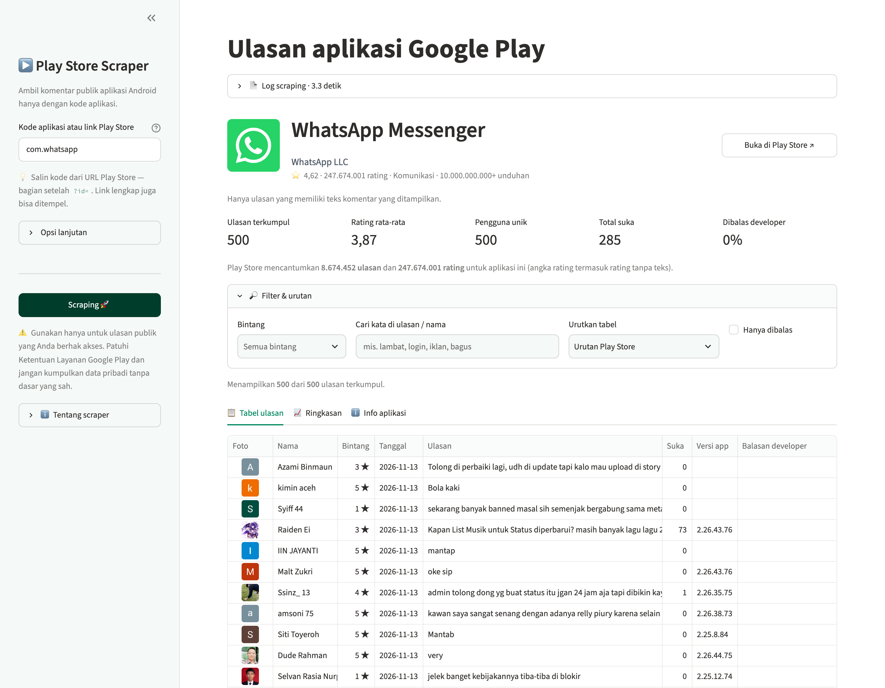

> **Pembaruan 14 November 2026:** jalur pengambilan default kini memakai
> browser `scrapling.fetchers.StealthySession` (stealth), termasuk permintaan
> endpoint Play Store, Yahoo Finance, dan YouTube. Instruksi/uraian mode HTTP
> lama di bawah merupakan dokumentasi sebelum migrasi; lihat
> [panduan stealth bersama](../STEALTH_MODE.md) untuk konfigurasi terbaru.

# Play Store Review Scraper



Ambil **komentar/ulasan publik** dari sebuah aplikasi Android di **Google Play
Store** hanya dengan memasukkan **kode aplikasi** (package id). Proyek ini
memakai **Python**, pustaka unofficial **`google-play-scraper`**, dan
**Streamlit** untuk antarmuka.

Konsepnya sama seperti proyek `x-tweet-scraper`, `threads-scraper`, dan
`gmaps-reviews-scraper`: scraping berjalan di background, log proses live,
ringkasan, filter, serta ekspor CSV/JSON — tanpa browser, login, atau API key.

> ## ⚠️ Baca sebelum memakai
>
> Proyek ini memakai pendekatan **script unofficial**
> [`Google-Play-Store-Review-Extractor`](https://github.com/amrrs/Google-Play-Store-Review-Extractor)
> di GitHub, yaitu permintaan HTTP ke endpoint publik Play Store — **bukan API
> resmi Google**.
>
> Gunakan hanya untuk **ulasan publik yang Anda berhak akses**, dengan
> izin/otorisasi yang sesuai, dan patuhi
> [Ketentuan Layanan Google Play](https://play.google.com/about/play-terms/)
> serta hukum yang berlaku. Aplikasi ini **tidak** melewati CAPTCHA, paywall,
> atau kontrol akses apa pun, dan tidak memakai proxy untuk menyamarkan diri.
> Untuk kebutuhan produksi, gunakan layanan/API resmi yang sesuai.

## Fitur

- Input **kode aplikasi** (`com.whatsapp`, `com.tokopedia.tkpd`, …) atau
  **link Play Store** lengkap.
- Validasi input: hanya kode aplikasi yang valid dan host `play.google.com`.
- Metadata aplikasi: nama, developer, ikon, rating, jumlah rating/ulasan,
  unduhan, genre, versi, tanggal pembaruan, iklan/IAP, dan deskripsi.
- Ambil ulasan per batch (maks. 200/batch) memakai **continuation token**,
  dengan deduplikasi berdasarkan ID ulasan.
- Opsi **bahasa & negara toko**, **urutan** (terbaru/relevan/rating), **filter
  bintang 1–5**, dan **hanya ulasan berteks**.
- **Tanpa batas jumlah**: biarkan jumlah ulasan di `0` untuk mengambil semua
  yang tersedia sampai feed habis atau dihentikan. Batas waktu opsional dan
  default-nya tanpa batas.
- Percobaan ulang otomatis saat gangguan jaringan + jeda sopan antar-batch.
- Proses di **background thread** dengan **log live**, penghitung progres,
  progress bar (bila jumlah target diisi), dan tombol **Hentikan**.
- Tabel hasil dengan foto profil, nama, bintang, tanggal, teks ulasan, jumlah
  suka, versi aplikasi, dan balasan developer.
- Filter bintang, pencarian kata, urutan tabel, dan opsi “hanya dibalas”.
- Ringkasan: distribusi bintang, ulasan per bulan, persentase dibalas developer,
  dan 10 ulasan paling disukai.
- Ekspor **CSV** (UTF-8 + BOM, langsung rapi di Excel) dan **JSON** (termasuk
  metadata aplikasi dan parameter scraping).

## Persyaratan

- **Python 3.10+** (diuji dengan Python 3.11)
- Koneksi internet ke Play Store
- macOS, Linux, atau Windows. Launcher klik-dua-kali disediakan untuk macOS.
- Tidak perlu Chrome, Selenium, atau API key.

## Instalasi

```bash
cd playstore-reviews-scraper

# 1. Virtual environment
python3.11 -m venv .venv
source .venv/bin/activate

# 2. Dependensi
pip install -r requirements.txt
```

## Menjalankan

### Cara cepat (macOS)

Klik dua kali **`Jalankan Play Store Scraper.command`**. Terminal akan membuka
aplikasi di browser. Tutup jendela Terminal untuk menghentikan server.

> Pertama kali: jika macOS memblokir, klik kanan file → **Open**, atau jalankan
> `chmod +x "Jalankan Play Store Scraper.command"` sekali.

### Manual

```bash
source .venv/bin/activate
streamlit run app.py
```

Buka URL yang muncul (biasanya <http://localhost:8501>).

## Alur pakai

1. Buka aplikasi di Play Store dan lihat URL-nya:
   `https://play.google.com/store/apps/details?id=com.whatsapp`.
2. Salin bagian setelah `?id=` (`com.whatsapp`) — atau tempel URL lengkapnya.
3. Di sidebar, atur bahasa/negara toko, urutan, jumlah ulasan, filter bintang,
   dan opsi lain bila perlu.
4. Klik **Scraping 🚀**. Log dan progress bar tampil langsung; UI tetap responsif.
5. Setelah selesai, saring/telusuri hasil di tab **Tabel ulasan**, lihat
   **Ringkasan**, lalu unduh **CSV** atau **JSON**.

Contoh kode aplikasi:

| Aplikasi | Kode aplikasi |
|---|---|
| WhatsApp Messenger | `com.whatsapp` |
| Instagram | `com.instagram.android` |
| Tokopedia | `com.tokopedia.tkpd` |
| Gojek | `com.gojek.app` |
| Spotify | `com.spotify.music` |

## Opsi di sidebar

| Opsi | Keterangan |
|---|---|
| Kode aplikasi / link | Input utama; link Play Store otomatis diambil `?id=`-nya. |
| Bahasa & negara toko | Menentukan toko yang dibaca, mis. `id/ID`, `en/US`. Ulasan bisa berbeda antar-toko. |
| Urutan dari Play Store | Terbaru, paling relevan, atau rating. |
| Filter bintang | 5/4/3/2/1 ★; difilter oleh endpoint Play Store, bukan setelah unduh. |
| Jumlah ulasan | `0` = **semua** ulasan yang tersedia, tanpa batas jumlah dari sisi aplikasi. Isi angka hanya bila ingin berhenti setelah jumlah tertentu. |
| Hanya ulasan berteks | Membuang rating tanpa komentar. |
| Jeda antar-batch | Default 0,6 detik; naikkan bila sering kena rate-limit. |
| Batas waktu | `0` = tanpa batas waktu. Isi angka bila ingin proses berhenti otomatis setelah durasi tertentu. |

## Kolom hasil

| Kolom CSV | Keterangan |
|---|---|
| `id_ulasan` | ID unik ulasan dari Play Store |
| `nama` | Nama pengulas |
| `rating` | 1–5 bintang |
| `tanggal` | Tanggal ulasan (`YYYY-MM-DD`) |
| `waktu` | Timestamp lengkap dari Play Store |
| `ulasan` | Teks komentar |
| `suka` | Jumlah “suka/membantu” pada ulasan |
| `versi_aplikasi` | Versi aplikasi saat ulasan ditulis (bila tersedia) |
| `versi_dibuat` | Versi aplikasi yang dicantumkan saat ulasan dibuat (bila ada) |
| `balasan` | Balasan developer, bila ada |
| `tanggal_balasan` | Tanggal balasan developer |
| `foto_profil` | URL foto profil pengulas |
| `aplikasi` | Nama aplikasi |
| `kode_aplikasi` | Package id aplikasi |

JSON berisi:

```json
{
  "aplikasi": { "id": "com.whatsapp", "nama": "WhatsApp Messenger", "...": "..." },
  "parameter": { "bahasa": "id", "negara": "id", "urutan": "terbaru" },
  "diambil_pada": "2026-11-14T...",
  "total": 500,
  "ulasan": [ { "id_ulasan": "...", "nama": "...", "ulasan": "..." } ]
}
```

## Cara kerja

1. **Metadata** diambil lewat `google_play_scraper.app()` menggunakan locale
   yang dipilih.
2. **Ulasan** diambil lewat `google_play_scraper.reviews()` per batch maksimum
   200, meneruskan `continuation_token` sampai target tercapai, feed habis,
   waktu habis, atau proses dibatalkan.
3. Filter bintang memakai `filter_score_with` bawaan pustaka. Setiap batch
   di-deduplikasi berdasarkan `reviewId`, dan opsi “hanya berteks” membuang
   ulasan tanpa komentar.
4. Gangguan jaringan dicoba ulang hingga tiga kali dengan jeda bertahap.
   Proses bisa dihentikan kapan saja; hasil yang sudah terkumpul tetap dipakai.
5. Baris dinormalisasi ke nama kolom Indonesia, lalu ditampilkan dan diekspor.

### Hubungan dengan script asli

Logika pengambilan di `scraper.py` **diadaptasi** dari
[`amrrs/Google-Play-Store-Review-Extractor`](https://github.com/amrrs/Google-Play-Store-Review-Extractor)
(`reviews_extraction.py`), yang memakai `google-play-scraper` untuk mengambil
ulasan dan menyimpannya sebagai CSV/JSON. Perbedaannya:

- Script asli adalah CLI satu kali jalan; proyek ini menambahkan antarmuka
  Streamlit, progres per batch, percobaan ulang, pembatalan, dan metadata
  aplikasi.
- Script asli memfilter bintang **setelah** unduh; proyek ini memakai filter
  bintang bawaan endpoint agar target jumlah lebih mudah tercapai.
- Script asli berhenti di jumlah yang diminta; proyek ini mendukung mode
  “semua yang tersedia” **tanpa batas jumlah** — proses berhenti saat
  continuation token habis, feed tidak memberi data baru, atau dihentikan
  pengguna.

## Kenapa hasilnya lebih sedikit dari angka di Play Store?

Angka **“8.674.443 ulasan”** pada halaman aplikasi adalah angka yang
dilaporkan Play Store. Feed ulasan yang bisa dimuat lewat endpoint publik bisa
lebih sedikit, dan bisa berhenti tanpa token lanjutan. Beberapa penyebab:

- Play Store membatasi atau menghentikan feed untuk locale/permintaan tertentu.
- Endpoint publik tidak selalu mengekspos seluruh ulasan yang dihitung di
  halaman aplikasi, bahkan saat diminta “semua”.
- Opsi **hanya ulasan berteks** membuang rating tanpa komentar.
- Filter bintang atau urutan tertentu mengurangi populasi ulasan.

Ini keterbatasan sumber data, bukan bug aplikasi. **“Tanpa batas” berarti
aplikasi tidak memotong jumlah data**, bukan jaminan bahwa Google akan
memberikan seluruh ulasan. Untuk data yang lengkap dan legal untuk produksi,
gunakan jalur resmi yang sesuai dengan kebutuhan Anda.

## Batasan

- **Unofficial**: `google-play-scraper` dapat berhenti bekerja bila Google
  mengubah endpoint. Tidak ada jaminan ketersediaan.
- Jumlah, urutan, dan ketersediaan ulasan ditentukan Google; tidak bisa
  dipaksakan dari sisi aplikasi.
- Ulasan yang tampil bergantung pada locale (bahasa/negara) dan filter.
- `waktu` mengikuti format yang dikembalikan Play Store; tidak selalu membawa
  informasi zona waktu.
- Nama pengulas bisa kosong; aplikasi menampilkan “Pengguna anonim”.
- Foto profil adalah URL publik dari Play Store; jangan diunduh/disebarkan tanpa
  dasar yang sah.
- Ulasan dapat memuat data pribadi. Hormati privasi dan jangan menyebarkan data
  pribadi tanpa dasar yang sah.
- Mode **semua** menyimpan seluruh baris di memori dan menampilkannya di tabel.
  Untuk aplikasi dengan jutaan ulasan, proses dan render bisa berat; hentikan
  kapan saja atau isi jumlah ulasan bila tidak perlu semuanya.

## Troubleshooting

**“Aplikasi tidak ditemukan”**\
Periksa kode aplikasi (harus mengandung titik, mis. `com.whatsapp`) dan coba
locale lain. Aplikasi region-locked mungkin tidak tersedia di toko tertentu.

**Tidak ada ulasan**\
Coba hapus filter bintang, matikan “hanya berteks”, atau ganti bahasa/negara.
Aplikasi baru/kecil bisa belum punya ulasan di toko itu.

**Hasil kurang dari jumlah yang diminta**\
Feed Play Store berhenti lebih awal, atau target berteks tidak terpenuhi. Coba
ulangi, turunkan filter, atau naikkan batas waktu. Ini normal untuk endpoint
publik.

**Gangguan jaringan / HTTP error**\
Aplikasi mencoba ulang otomatis. Bila tetap gagal, tunggu beberapa menit,
naikkan **Jeda antar-batch**, lalu coba lagi.

**Proses lama**\
Mode “semua” pada aplikasi populer bisa memakan waktu sangat lama karena jumlah
ulasannya jutaan. Klik **Hentikan** kapan saja — hasil sementara tetap bisa
diunduh — atau isi jumlah ulasan/batas waktu bila tidak ingin menunggu semua.

**CSV berantakan di Excel**\
File CSV sudah memakai UTF-8 + BOM. Bila masih bermasalah, impor lewat
**Data → From Text/CSV** dan pilih UTF-8.

## Struktur proyek

```
playstore-reviews-scraper/
├── Jalankan Play Store Scraper.command  # Launcher macOS
├── app.py                 # Antarmuka Streamlit
├── scraper.py             # Logika scraping, normalisasi, ekspor
├── requirements.txt
├── README.md
├── preview.png
└── .streamlit/
    └── config.toml
```

## Kredit

- Script asal: [amrrs/Google-Play-Store-Review-Extractor](https://github.com/amrrs/Google-Play-Store-Review-Extractor)
- Pustaka: [google-play-scraper](https://pypi.org/project/google-play-scraper/)
- Antarmuka: [Streamlit](https://streamlit.io/)

Proyek ini tidak berafiliasi dengan Google. Google Play adalah merek dagang
Google LLC.
