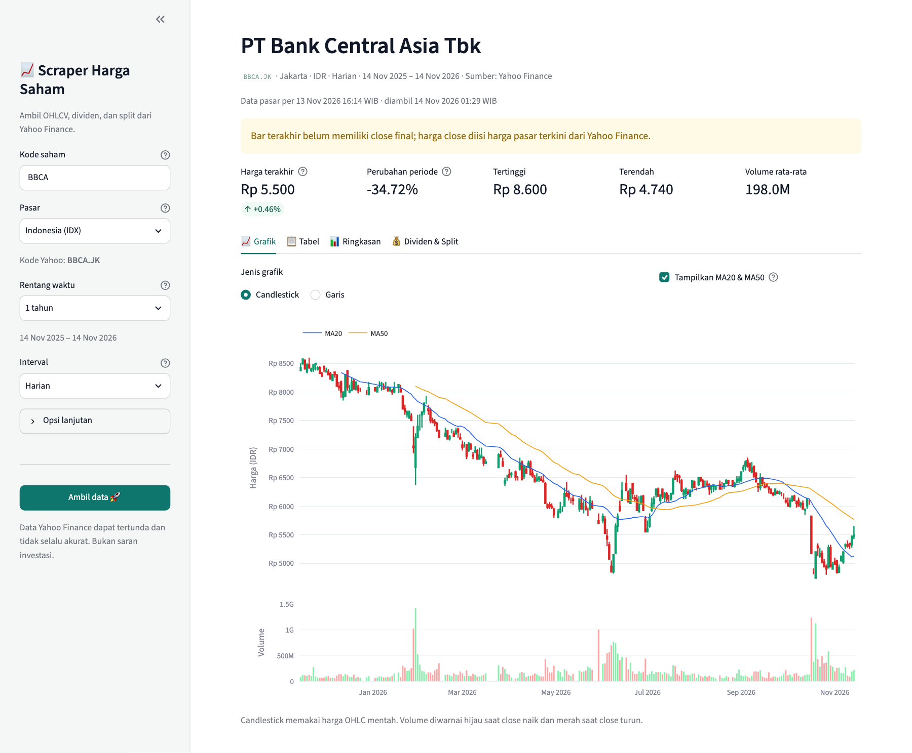

> **Pembaruan 14 November 2026:** jalur pengambilan default kini memakai
> browser `scrapling.fetchers.StealthySession` (stealth), termasuk permintaan
> endpoint Play Store, Yahoo Finance, dan YouTube. Instruksi/uraian mode HTTP
> lama di bawah merupakan dokumentasi sebelum migrasi; lihat
> [panduan stealth bersama](../STEALTH_MODE.md) untuk konfigurasi terbaru.

# Scraper Harga Saham — Yahoo Finance

Ambil data harga saham (**OHLCV**), **dividen**, dan **split** dari **Yahoo Finance**
berdasarkan **kode saham** dan **rentang waktu**. Dibuat dengan **Python** dan
antarmuka **Streamlit**, mengikuti konsep proyek **X Tweet Scraper**.

Tidak perlu API key. Data diambil langsung dari endpoint chart publik Yahoo Finance.



## Fitur

- Input **kode saham** + pilihan pasar: **IDX**, **Amerika Serikat**, **Kripto**,
  atau **Kustom**. Akhiran `.JK` / `-USD` ditambahkan otomatis bila perlu.
- **Rentang waktu** cepat: 1 bulan, 3 bulan, 6 bulan, 1 tahun, 3 tahun, 5 tahun,
  YTD, maksimum, atau **Kustom** (pilih tanggal sendiri).
- Interval **Harian**, **Mingguan**, atau **Bulanan**.
- **Log proses tampil langsung** saat data diambil (background thread).
- Retry otomatis + fallback host `query2` / `query1` + impersonasi browser
  (`curl_cffi`) untuk mengurangi blokir HTTP 429.
- Ringkasan metrik: harga terakhir, perubahan periode, tertinggi, terendah,
  volume rata-rata.
- Grafik **candlestick** / **garis** dengan **MA20 & MA50** dan volume.
- Tabel OHLCV lengkap + **Adj Close** + perubahan persen.
- Tab **Ringkasan**: volatilitas tahunan, max drawdown, return terbaik/terburuk,
  return per bulan, dan kurva drawdown.
- Tab **Dividen & Split** bila tersedia pada rentang tersebut.
- Ekspor hasil ke **CSV** dan **JSON**.
- Launcher klik-dua-kali untuk macOS.

## Persyaratan

- **Python 3.10+** (diuji dengan 3.11)
- Koneksi internet ke Yahoo Finance

## Instalasi

```bash
cd saham-scraper

# 1. Buat virtual environment
python3.11 -m venv .venv
source .venv/bin/activate

# 2. Install dependensi
pip install -r requirements.txt
```

## Menjalankan

### Cara cepat (macOS)

Klik dua kali file **`Jalankan Saham Scraper.command`**. Terminal akan terbuka,
environment dicek/dibuat otomatis, lalu aplikasi terbuka di browser. Tutup
jendela Terminal untuk menghentikan aplikasi.

> Pertama kali: jika macOS memblokir, klik kanan file → **Open**, atau jalankan
> `chmod +x "Jalankan Saham Scraper.command"` sekali.

### Cara manual

```bash
source .venv/bin/activate
streamlit run app.py
```

Lalu buka URL yang muncul (biasanya <http://localhost:8501>).

### Alur pakai

1. Pilih **pasar** di sidebar.
2. Isi **kode saham** — mis. `BBCA` untuk IDX, `AAPL` untuk AS, `BTC-USD` untuk kripto.
3. Pilih **rentang waktu** dan **interval**.
4. Klik **Ambil data 🚀** dan lihat log berjalan.
5. Jelajahi tab **Grafik**, **Tabel**, **Ringkasan**, **Dividen & Split**, lalu
   unduh **CSV** / **JSON**.

## Panduan kode saham

| Pasar | Contoh input | Kode yang dipakai |
| --- | --- | --- |
| Indonesia (IDX) | `BBCA`, `TLKM`, `ASII`, `^JKSE` | `BBCA.JK`, `TLKM.JK`, `ASII.JK`, `^JKSE` |
| Amerika Serikat | `AAPL`, `MSFT`, `SPY` | `AAPL`, `MSFT`, `SPY` |
| Kripto | `BTC`, `ETH-USD` | `BTC-USD`, `ETH-USD` |
| Kustom | `0700.HK`, `7203.T`, `EURUSD=X` | apa adanya |

Untuk pasar **Kustom**, kode dipakai persis seperti yang diketik. Ini berguna
untuk bursa lain (Hong Kong, Tokyo, dll.) atau pasangan forex.

## Sumber data & kolom

Endpoint:

```text
GET https://query2.finance.yahoo.com/v8/finance/chart/{symbol}
    ?period1=<epoch>&period2=<epoch>&interval=1d
    &events=div,splits&includeAdjustedClose=true
```

Kolom data: `date`, `open`, `high`, `low`, `close`, `adj_close`, `volume`,
`change_pct`. `change_pct` dihitung terhadap close bar sebelumnya; baris pertama
memakai `chartPreviousClose` dari Yahoo (close sebelum rentang) agar tetap ada
pembanding.

Nama perusahaan, bursa, mata uang, harga pasar terakhir, dan rentang 52 minggu
diambil dari bagian `meta` respons Yahoo.

## Catatan penting

- Yahoo Finance memakai API publik yang **tidak resmi** dan bisa berubah kapan saja.
- Harga dapat **tertunda** (umumnya 15–20 menit untuk saham) dan tidak dijamin
  lengkap/akurat. Aplikasi ini **bukan saran investasi**.
- Jika muncul **HTTP 429**, Yahoo sedang membatasi permintaan. Tunggu 1–2 menit
  lalu coba lagi. Aplikasi sudah mencoba ulang otomatis dengan jeda.
- Bar hari berjalan yang belum memiliki `close` diisi dengan **harga pasar
  terkini** dari Yahoo; aplikasi menampilkan peringatan bila ini terjadi.
- `Adj Close` menyesuaikan harga terhadap dividen/split. Jika Yahoo tidak
  menyediakannya, kolom diisi sama dengan `Close`.
- Untuk rentang yang hanya berisi akhir pekan/hari libur, tidak ada bar yang
  dikembalikan. Gunakan rentang lebih panjang.
- Dividen ditampilkan per saham dalam mata uang instrumen, sebelum pajak.

## Struktur proyek

```text
saham-scraper/
├── Jalankan Saham Scraper.command  # Launcher klik-dua-kali (macOS)
├── app.py                          # Antarmuka Streamlit
├── scraper.py                      # Logika API Yahoo Finance
├── requirements.txt
├── preview.png                     # Tangkapan layar tampilan
├── README.md
└── .streamlit/config.toml          # Tema & konfigurasi server
```

## Troubleshooting

- **Kode tidak ditemukan** — pastikan pasar benar. Saham IDX butuh `.JK`
  (ditambahkan otomatis), kripto butuh pasangan seperti `BTC-USD`.
- **HTTP 429 / dibatasi** — tunggu sebentar, kurangi frekuensi pengambilan,
  lalu coba lagi.
- **Tidak ada data** — perpanjang rentang atau ganti interval.
- **Grafik kosong** — pastikan minimal ada dua bar dalam rentang.
- **Instalasi `curl_cffi` gagal** — gunakan Python 3.11/3.12 64-bit terbaru,
  lalu ulangi `pip install -r requirements.txt`.
