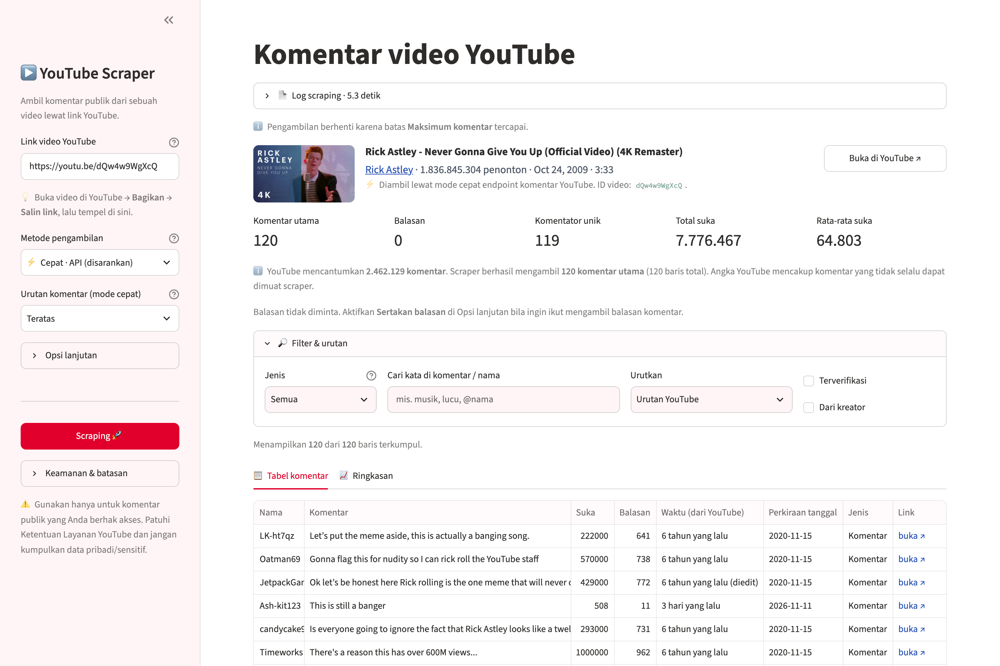

> **Pembaruan 14 November 2026:** jalur pengambilan default kini memakai
> browser `scrapling.fetchers.StealthySession` (stealth), termasuk permintaan
> endpoint Play Store, Yahoo Finance, dan YouTube. Instruksi/uraian mode HTTP
> lama di bawah merupakan dokumentasi sebelum migrasi; lihat
> [panduan stealth bersama](../STEALTH_MODE.md) untuk konfigurasi terbaru.

# YouTube Comment Scraper



Ambil **komentar publik** dari sebuah video YouTube hanya dengan menempelkan
link videonya. Proyek ini memakai **Python + Scrapling** dan **Streamlit** untuk
antarmuka, dengan dua mode pengambilan:

- **⚡ Cepat (API)** — memakai endpoint komentar internal YouTube
  (`youtubei/v1/next`) dengan *continuation token*. Tanpa browser, tanpa login,
  dan bisa mengambil ribuan komentar dalam hitungan menit.
- **🖥️ Browser** — cadangan. Membuka halaman video dengan `StealthySession`,
  menggulir bagian komentar, lalu mengekstrak kartu komentar dari DOM.

Konsepnya sama seperti proyek `gmaps-reviews-scraper`, `playstore-reviews-scraper`,
`threads-scraper`, dan `x-tweet-scraper`: scraping berjalan di **background
thread**, ada **log live**, tabel hasil, filter, ringkasan, serta ekspor
**CSV/JSON**.

> ## ⚠️ Baca sebelum memakai
>
> YouTube tidak secara bebas mengizinkan pengambilan data otomatis. Gunakan
> proyek ini hanya untuk **komentar publik yang Anda berhak akses**, dengan
> izin/otorisasi yang sesuai, dan patuhi
> [Ketentuan Layanan YouTube](https://www.youtube.com/t/terms) serta hukum yang
> berlaku.
>
> Endpoint mode cepat adalah **API internal YouTube yang tidak terdokumentasi
> resmi** dan dapat berubah atau ditutup kapan saja. Aplikasi ini **tidak**
> melewati CAPTCHA, paywall, login, atau kontrol akses apa pun, dan tidak
> memakai proxy untuk menyamarkan diri. Untuk kebutuhan produksi, gunakan
> **YouTube Data API v3** resmi.

## Fitur

- Input **link video YouTube**: `youtube.com/watch?v=…`, `youtu.be/…`,
  `youtube.com/shorts/…`, `youtube.com/live/…`, `embed`, atau ID video 11 karakter.
- Validasi link: hanya host YouTube yang diproses; link channel/playlist ditolak.
- **Mode cepat**: ambil komentar per halaman (sekitar 20 komentar/halaman) lewat
  continuation token, dengan pilihan urutan **Teratas** atau **Terbaru**.
- **Mode browser**: buka halaman video, gulir komentar, perluas teks yang
  terpotong, lalu ekstrak dari DOM.
- Metadata video: judul, kanal, jumlah penonton, tanggal publikasi, durasi,
  thumbnail, dan link video.
- Ambil data: nama komentator, isi komentar, jumlah suka, jumlah balasan,
  label waktu relatif, perkiraan tanggal, status terverifikasi, status kreator,
  ID kanal, URL kanal, foto profil, ID komentar, dan link langsung ke komentar.
- **Balasan komentar opsional** (mode cepat) dengan batas per komentar.
- Batas maksimum komentar, batas waktu, dan jeda sopan antar-permintaan.
- **Log live** + penghitung progres, proses di background, dan tombol
  **Hentikan**.
- Filter jenis (komentar/balasan), pencarian kata/nama, filter terverifikasi/
  kreator, dan pengurutan tabel.
- Ringkasan: 10 komentar paling disukai, perkiraan komentar per bulan, dan
  10 komentator paling aktif.
- Ekspor **CSV** (UTF-8 + BOM, rapi di Excel) dan **JSON**.

## Persyaratan

- **Python 3.10+** (diuji dengan Python 3.11)
- Koneksi internet ke YouTube
- Untuk mode browser: Google Chrome terpasang (disarankan) atau Chromium dari
  Scrapling
- macOS, Linux, atau Windows. Launcher klik-dua-kali disediakan untuk macOS.
- **Tidak perlu login YouTube atau API key.**

## Instalasi

```bash
cd youtube-comments-scraper

# 1. Virtual environment
python3.11 -m venv .venv
source .venv/bin/activate

# 2. Dependensi
pip install -r requirements.txt

# 3. (Opsional) browser Chromium untuk Scrapling, hanya jika memakai mode browser
scrapling install --force
```

> `requirements.txt` menyertakan `certifi` agar `curl_cffi` (mesin HTTP
> Scrapling) menemukan CA bundle di macOS. Tanpa itu, permintaan HTTPS bisa
> gagal dengan error sertifikat.

## Menjalankan

### Cara cepat (macOS)

Klik dua kali **`Jalankan YouTube Scraper.command`**. Terminal akan membuka
aplikasi di browser. Tutup jendela Terminal untuk menghentikan server.

> Pertama kali: jika macOS memblokir, klik kanan file → **Open**, atau jalankan
> `chmod +x "Jalankan YouTube Scraper.command"` sekali.

### Manual

```bash
source .venv/bin/activate
streamlit run app.py
```

Buka URL yang muncul (biasanya <http://localhost:8501>).

## Alur pakai

1. Buka video di YouTube → **Bagikan** → **Salin link**.
2. Tempel link di sidebar aplikasi.
3. Pilih **metode pengambilan** (disarankan **⚡ Cepat**).
4. Atur **Maksimum komentar**, urutan, dan balasan bila perlu.
5. Klik **Scraping 🚀** dan lihat log live.
6. Setelah selesai, filter/telusuri hasil lalu unduh **CSV** atau **JSON**.

> Untuk video populer, jangan biarkan **Maksimum komentar = 0** pada percobaan
> pertama. Video dengan jutaan komentar dapat menghabiskan batas waktu tanpa
> selesai. Mulailah dari 100–500 komentar.

## Mode cepat vs mode browser

**Mode cepat** mengambil halaman tonton sekali dengan `FetcherSession` untuk
mendapatkan `INNERTUBE_API_KEY`, versi client, dan token komentar. Selanjutnya
komentar diambil lewat `POST youtubei/v1/next`. Setiap respons berisi sekitar
20 komentar, data penulis, jumlah suka, jumlah balasan, dan token halaman
berikutnya. Pada pengujian, ratusan komentar dapat diambil dalam beberapa detik
dan ribuan komentar dalam hitungan menit.

**Mode browser** memakai `StealthySession` untuk membuka halaman video seperti
manusia, menggulir ke bagian komentar, mengeklik tombol **Lainnya/Selengkapnya**,
lalu mengekstrak `ytd-comment-thread-renderer`. Mode ini lebih lambat (±20
komentar per batch gulir), tidak mengambil balasan, dan bergantung pada struktur
DOM YouTube yang sering berubah. Gunakan sebagai cadangan bila mode cepat gagal.

## Cara kerja

### Mode cepat

1. Link dinormalisasi menjadi `https://www.youtube.com/watch?v=<id>&hl=id&gl=ID`.
2. `FetcherSession(impersonate="chrome")` mengambil halaman tonton.
3. Scraper membaca `ytInitialData`, `ytInitialPlayerResponse`, dan `ytcfg` untuk
   mendapatkan metadata video, kunci API internal, dan token bagian komentar.
4. Token urutan **Teratas/Terbaru** diambil dari menu sortir komentar YouTube.
5. Komentar diambil lewat `youtubei/v1/next`; data utama ada di
   `frameworkUpdates.entityBatchUpdate.mutations` (`commentEntityPayload`).
6. Setiap komentar dideduplikasi berdasarkan `commentId`. Jika diminta, balasan
   diambil lewat token balasan milik komentar induk dan diberi `id_induk`.
7. Proses berhenti saat batas komentar/waktu tercapai, pengguna menekan
   **Hentikan**, token habis, atau YouTube menolak permintaan.

### Mode browser

1. `StealthySession` membuka link video dengan locale `id-ID`.
2. Aplikasi menunggu halaman stabil, menggulir ke bagian komentar, dan memuat
   batch komentar pertama.
3. Setiap gulir: perluas teks terpotong, ekstrak kartu komentar, lalu gulir lagi.
4. Komentar dideduplikasi berdasarkan ID (`lc=` pada link waktu komentar) atau
   kombinasi nama + waktu + teks.
5. Tanggal relatif seperti “7 tahun yang lalu” diubah menjadi **perkiraan**
   tanggal absolut (bulan = 30 hari, tahun = 365 hari).

## Kolom hasil

| Kolom | Keterangan |
|---|---|
| `id_komentar` | ID komentar YouTube |
| `jenis` | `komentar` (utama) atau `balasan` |
| `id_induk` | ID komentar induk untuk baris balasan |
| `level` | 0 untuk komentar utama, 1 untuk balasan |
| `nama` | Nama/handle komentator |
| `komentar` | Isi komentar lengkap |
| `suka` | Jumlah suka (angka ringkas seperti “72 rb” dikonversi) |
| `balasan` | Jumlah balasan pada komentar utama |
| `waktu` | Label waktu asli dari YouTube (mis. “7 tahun yang lalu”) |
| `perkiraan_tanggal` | Perkiraan tanggal `YYYY-MM-DD` dari label relatif |
| `terverifikasi` | Kanal komentator terverifikasi (mode cepat) |
| `kreator` | Komentar berasal dari pemilik kanal video (mode cepat) |
| `kanal_id` | ID kanal komentator |
| `profil` | URL kanal komentator |
| `foto_profil` | URL foto profil |
| `link_komentar` | Link langsung ke komentar (`&lc=…`) |
| `video_id`, `judul_video`, `link_video` | Metadata video |

## Soal jumlah komentar

Angka **“2.462.124 komentar”** di halaman YouTube adalah jumlah yang dicantumkan
YouTube, termasuk komentar yang tidak selalu dapat dimuat scraper (komentar
dihapus, dibatasi, atau tidak disediakan endpoint). Jumlah baris hasil bisa
berbeda karena:

- scraper berhenti saat **Maksimum komentar** atau **Waktu maksimum** tercapai;
- balasan bersifat opsional dan dibatasi per komentar;
- YouTube dapat membatasi atau mengubah respons kapan saja.

Jadi, jangan menyamakan “2,4 juta komentar” dengan jumlah baris yang berhasil
diunduh. Untuk data produksi yang lengkap dan legal, gunakan **YouTube Data API
v3** resmi (dengan kuota yang sesuai).

## Batasan

- **Mode cepat** bergantung pada API internal YouTube; dapat berhenti atau
  berubah tanpa pemberitahuan.
- **Mode browser** lebih lambat, tidak mengambil balasan, dan sangat bergantung
  pada selector DOM `ytd-comment-*`.
- Komentar video yang dinonaktifkan, video privat, atau video yang memerlukan
  login/verifikasi usia tidak dapat diambil tanpa akun.
- Tanggal absolut hanyalah perkiraan dari label relatif YouTube.
- Jumlah suka pada label ringkas (“72 rb”) dibulatkan sesuai tampilan YouTube.
- Komentar dapat memuat data pribadi. Jangan menyebarkan data pribadi tanpa
  dasar yang sah.
- YouTube dapat membatasi akses kapan saja. Tidak ada jaminan hasil selalu
  tersedia.

## Troubleshooting

**Hanya dapat sedikit komentar / berhenti cepat**\
Naikkan **Maksimum komentar** dan **Waktu maksimum**, lalu ulangi. Untuk video
populer, mode cepat tetap jauh lebih cepat daripada mode browser.

**Mode cepat gagal, muncul “Respons Innertube tidak dikenali”**\
YouTube mungkin mengubah format respons. Coba lagi nanti, atau gunakan **mode
browser**. Jika tetap gagal, selector/parser di `scraper.py` perlu diperbarui.

**Komentar dinonaktifkan**\
Video memang tidak menyediakan komentar publik. Tidak ada yang bisa diambil.

**Video meminta login / verifikasi usia**\
Scraper tidak memakai akun. Video seperti ini tidak dapat diambil.

**Chrome gagal dibuka (mode browser)**\
Nonaktifkan **“Gunakan Google Chrome asli”** di Opsi lanjutan, atau pastikan
dependensi browser terpasang (`scrapling install --force`).

**Error sertifikat SSL**\
Pastikan `certifi` terpasang (`pip install certifi`). Scraper otomatis memakai
CA bundle dari `certifi` saat tersedia.

**Proses lama / seolah berhenti**\
Lihat panel log live. Gunakan tombol **Hentikan** bila perlu. Turunkan
**Maksimum komentar** untuk percobaan berikutnya.

## Struktur proyek

```
youtube-comments-scraper/
├── Jalankan YouTube Scraper.command  # Launcher macOS
├── app.py                 # Antarmuka Streamlit
├── scraper.py             # Logika scraping & parsing (Scrapling)
├── requirements.txt
├── README.md
├── preview.png
└── .streamlit/
    └── config.toml
```

> Tidak ada folder sesi/login: proyek ini tidak memakai akun YouTube. Jangan
> menambahkan cookie atau kredensial pribadi ke dalam proyek.
